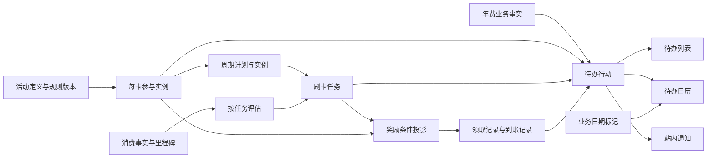

# 按卡活动、周期奖励与待办架构

版本：v0.3（补充平台目录来源与私人参与边界） 
设计日期：2026-10-09 
状态：架构设计，待实施；本文不表示功能已经上线。 
需求依据：[工作台 PRD 第 21、22 节](./PRD-WORKBENCH.md#21-按卡活动周期目标奖励领取与日历待办2026-10-09)。 
关联设计：[工作台领域架构](./ARCHITECTURE-WORKBENCH.md)、[前端架构](./FRONTEND-ARCHITECTURE.md)、[已有数据库约束](./DATABASE-WORKBENCH.md)、[第 23 节银行活动目录](./ARCHITECTURE-ACTIVITY-CATALOG.md)。

2026-10-13 实施补充：[第 21、22 节后端补齐合同](./ARCHITECTURE-CC21-22-BACKEND.md) 按现有 0005/0006 表、已交付目录后端和真实前端请求明确增量迁移、公共私人 runtime、年费/自定义待办、周期/消费/奖励、job 与验收；已直接交给“后端仔”实施。本文的目标模块描述应结合该合同和实际交付报告阅读。

## 1. 设计结论与范围

沿用模块化单体。以“活动定义 → 每卡参与 → 有限周期 → 刷卡任务 → 奖励组件”组织第 21 节；以独立 `TodoAction` 组织第 22 节。列表、日历和首页读取同一批行动，提醒作为这些行动或业务日期节点的通知。

三个边界必须贯穿接口、数据库和前端：

- 业务事实由所属领域的命令维护。报名、目标达到、用户确认达标、提交领取、确认领取和实际到账分别记录。
- 待办记录用户要做的事；完成待办不反向确认业务事实。
- 日历是查询视图。行动可以完成，单纯活动起止等日期标记不能完成。

本次覆盖年费接入待办、按卡活动、四类有限周期、周期/最终/全期目标奖励、领取窗口、自定义待办、站内提醒和历史。权益账本、积分记账和兑换继续按既有 P1 发布边界推进。

箭头表示引用、评估或事件驱动的投影。任务目标达到不自动产生领取、到账、积分或权益事实。

## 2. 当前代码与新增模块

检查基线为 `8177312`，并读取了工作区中最新的 PRD。现有 `src/modules` 有年费、周期、进度、提醒等模块；当前 `Reminder` 只关联年费事件/周期，当前日历只读取 `FeeEvent`。现有代码没有活动周期、领奖或独立待办实体。

下表是逻辑模块及建议目录；已有 `cards`、`fee-events`、`reminders` 等目录保留。

| 模块 | 拥有的写模型 | 对外职责 |
| --- | --- | --- |
| `source-snapshot` / `rule-version` | 来源快照、不可变规则版本 | 保存来源、核对时间、适用口径和版本 |
| `campaign` | Campaign、规则版本中的周期/奖励模板 | 活动身份、有效期、共享规则定义 |
| `participation` | ActivityParticipation、PeriodPlanRevision、ActivityPeriod、报名尝试 | 每卡参与、实际周期计划及实例、按范围核对资格/报名/名额 |
| `spend-task` | SpendTask、消费事实、任务评估、里程碑 | 绑定参与周期，预计/确定进度、人工达标核对、退款影响 |
| `activity-reward` | ActivityRewardComponent、领取尝试、到账事件 | 奖励归属、领取与到账事实、条件依赖和核对状态 |
| `todos` | TodoAction、行动历史、节点展示/提醒偏好 | 待办生成、完成、忽略、恢复、稍后处理和日期同步 |
| `reminders` | Reminder、投递尝试 | 提前通知、延期、取消、重试；沿用通知历史 |
| `workbench-query` | 可重建的查询投影 | 按卡活动摘要、详情、待办分组、日历和首页聚合 |

模块内部按接口、用例、领域、仓储/队列适配分层。跨模块调用公开命令或查询端口，后台协作用 outbox/inbox；不导入其他模块的 repository。用户交互中必须一起生效的业务结果、条件投影、待办和通知调度由服务端 workflow 通过公共端口共享事务，具体范围见第 7 节。查询模块只读取公开查询端口或专门授权的只读视图，不在 GET 时补写周期或待办。

## 3. 活动与有限周期

### 3.1 身份、归属和唯一键

继续使用 `(owner_user_id, campaign_id, card_id, activity_instance_key)` 标识参与实例。`activity_instance_key` 标识一次有明确边界的活动批次，例如“2026 年 10—12 月”；它不使用可修改的日期或规则版本号生成。

同一参与实例下，`ActivityPeriod` 标识月度/账单/自定义统计周期，使用稳定 `period_key`。示例中 10、11、12 月是三个 period，不是三个互相无关联的活动。下一年度活动建立新的参与实例；不复用旧历史。

周期实例归 participation 模块，刷卡任务和奖励通过公开端口引用。这样无消费目标的报名/领奖活动也可以有周期。Campaign 的周期模板不直接修改某张卡的实例计划。

资格、报名与名额的适用范围显式为 `participation` 或 `period`。每期重新报名时，尝试绑定 `period_id`，序号在 `(owner, participation, scope_key)` 内独立递增；10 月报名确认不能覆盖 11 月。一次报名覆盖全期时，规则必须明确 scope 与适用周期，不能由空 period ID 推断。任务和奖励校验各自实际范围的核对事实，participation 摘要只作组合展示。

建议关键业务键：

| 对象 | 唯一范围 |
| --- | --- |
| 周期 | `(owner, participation, period_key)` |
| 周期刷卡任务 | `(owner, participation, period_key, task_key)` |
| 全期刷卡任务 | `(owner, participation, task_key)`，独立于月度任务 |
| 奖励组件 | `(owner, participation, reward_scope_key, reward_key)` |
| 同一消费的任务评估 | `(owner, spend_fact_id, task_id)`，评估修订追加版本 |

同一活动适用两张卡时，参与、周期、任务、奖励和行动均按卡分开。所有引用校验完整 owner/card/participation 链。

### 3.2 周期计划与生成

participation 模块的 `PeriodPlanRevision` 保存该卡参与的有限活动起止日、周期类型、IANA 时区、周期边界、各期目标、首尾不足期政策和来源版本。`ActivityPeriod` 固定引用计划版本，并保存 `start_on/end_on`、逻辑周期键和阶段；任务由 spend-task 模块按稳定周期 ID 绑定，奖励也可以独立引用周期。

| 周期类型 | 生成规则 |
| --- | --- |
| 自然月 | 按活动时区的月初切分，在有限活动区间内生成 |
| 账单周期 | 录入已核对的明确边界或完整可计算规则及例外；只有账单日不能激活生成 |
| 自定义 | 用户显式给出周期区间，检查顺序和重叠 |
| 整个活动期一次性 | 生成一个覆盖完整活动区间的任务 |

沿用现有契约的包含端点日期窗：`start_on <= date <= end_on`。生成器内部可使用 `[start, next_start)`，落库时取 `end_on = next_start - 1 个本地日`，避免相邻周期重复包含日期。不得用固定 24 小时相加生成夏令时地区的本地边界。

有限区间一次预览、确认后幂等生成；超出单次处理规模分批执行，显示生成状态，不静默截断周期。首尾不足期不按天折算目标：规则明确才生成确定目标，否则保存计划及待核对原因。每期可以有不同目标，超额不默认结转。

周期阶段为 `planned/active/ended/cancelled`；规则可信度及人工确认状态独立。到期可以结束统计窗口，但不能自动断言银行拒绝奖励。

### 3.3 修改未来周期

编辑规则产生新版本，并显式选择受影响的未来周期。未启动且没有消费/确认记录的周期可引用新计划版本，保留修订历史和原版本；逻辑周期 ID 保持稳定，关联待办更新日期而非重建身份。已启动或结束周期保留冻结快照；需要修正时创建显式修订并标记待核对，不覆盖历史证据。

奖励依赖的周期集合固定在版本中。取消一个周期不能把“3/3”静默改成“2/2”；是否改变最终奖励条件必须有来源、新规则版本和用户核对记录。

## 4. 进度与同一消费的关联

### 4.1 计算与人工确认分开

首版自动计算只支持 `count/amount/count_and_amount/count_or_amount`。自定义及未支持的单笔条件保留原文，不能按已支持条件计算后宣称整个规则满足。

每个任务固定币种、次数/金额目标、`all/any`、统计窗、时区、消费方式快照、`occurred/posted/settled` 口径及排除项。未知关键口径阻止激活确定计算，但允许保存计划。

响应分别给出 `confirmedProgress`、`pendingProgress`、`remaining`、各指标完成度、`progressStatus`、`qualificationStatus`、`reviewStatus`。预计满足目标与确定满足目标分别显示；确定满足仍不等于用户已在官方渠道核对。金额在数据库使用既有受控精度，API 传十进制字符串，前端不使用浮点求和决定达标。

### 4.2 快照与逐条模式互斥

每任务只选择 `snapshot` 或 `entries`：

- 快照模式追加累计观察及差额修订，保留此前数值、来源和核对日期。
- 逐条模式从消费事实及任务评估重放；入账/清算使用追加里程碑。
- 已有记录后切换模式必须执行显式迁移、核对和审计，不能只改前端开关再把两种数值相加。

### 4.3 全期累计需要同源消费事实

第 21 节要求月度任务与全期独立目标可共存，本次选择落实已有架构第 23.2 节的 `SpendFact + SpendTaskEvaluation` 关联方案：

1. 原始消费金额、卡片、发生日期和业务去重键只保存一次。SpendFact 按 owner/card 归属，录入 participation 只是上下文；同卡其他合法任务可显式引用同一事实，各自核对规则。
2. 同一消费分别关联本月任务、全期任务或其他允许的任务，每份评估固定该任务规则及计入口径。
3. 每个任务内只计一次；跨任务页面不能把这些目标进度相加成“总消费”。
4. 退款关联原事实，所有受影响评估重算；次数是否扣回须有明确规则，未知则待核对。

对外入账/清算命令沿用 `/spend-entries/{entryId}/milestones`；`entryId` 定位唯一消费事实。旧任务级 entry 创建接口作为 facade 调用同一事实命令，不能另存一份金额。任务评估有独立 ID，不能把 evaluation ID 当作原始消费 ID。

录入提供“新记录/关联已有记录”两个明确动作。已知同一事实必须引用已有 ID；只有金额和日期相同不能证明是重复交易，不能据此误删真实消费。稳定外部引用或用户录入业务键用于重试去重；渠道/MCC 不明确时只保存观察及待核对评估。

累计模式的全期任务必须有独立的累计观察，不把各月“达标”标签当全期进度，也不在缺少相同币种、边界和口径证据时自动相加月度快照。关联模型及退款回放未通过验证前，关闭跨任务关联入口。

## 5. 奖励条件、领取与到账

### 5.1 奖励组件与条件依赖

每个 `ActivityRewardComponent` 拥有类型、名称、已知数量/金额及单位、未知说明、来源版本、获取方式、条件依赖、领取窗口、预计到账规则、实际到账事件和独立 review 状态。

| 奖励范围 | 固定依赖 | 展示 |
| --- | --- | --- |
| 每周期独立奖励 | 某个 period 的任务和资格核对 | 各期分别核对、领取和到账 |
| 所有周期均达标的最终奖励 | 明确 `required_period_ids` 集合 | “已确认 1/3”，缺一期不能显示条件已齐 |
| 全期累计奖励 | 独立 overall SpendTask | 展示全期目标，不用月度达标数量替代 |

条件投影 `unknown/not_met/met` 根据确定进度、当前人工确认、资格/报名/名额及规则计算；显示的是记录的条件核对情况，不能声称银行已发奖。条件变化不会自动写领取或到账事件。退款影响已核对条件时，相关任务/奖励进入待核对，保留此前确认；已到账奖励不能自动变成撤回。

### 5.2 领取轴和到账轴

| 维度 | 写入事实或派生结果 |
| --- | --- |
| 获取方式 | `automatic/manual/unknown`；未知不预填自动或主动 |
| 领取事实 | `not_required/not_started/submitted/confirmed/needs_review`，由追加领取尝试和结果重放 |
| 领取窗口 | `not_open/open/closed/unknown`，按明确来源日期和当前时间派生 |
| 到账状态 | 沿用 `expected_pending/delayed/received/reversed/unknown`；争议由独立 review 轴表达 |

产品的“已过领取期限”由窗口关闭与领取尚未确认组成，不用时钟伪造银行拒绝结果。`automatic` 的领取事实为 `not_required`，不生成“去领取”；`manual` 记录渠道、官方入口、开始/截止及说明。提交领取、确认领取、确认实际收到分别使用命令并保留时间和证据。

领取尝试使用追加序号；重放同一请求不创建第二次尝试。记录外部官方渠道已完成的历史结果允许事后补记，保存实际发生时间与录入时间；窗口关闭后不能把新的计划提交显示为当前可领取。

到账事件按组件记录实际日期、数量/金额及证据。已知总量时可以显示部分到账与剩余量；只收到账一项不完成其他组件。未知总量不得以 0 或一次到账推断全部收到。

预计到账仅在基准日、计日规则和必要日历明确时推算。例如“次月 15 日”可以由确定周期计算；未定义工作日规则保留原文并生成无日期核对行动。预计日不是硬性截止日。

### 5.3 结束、取消和归档

活动自然结束后，未领取奖励继续可查询和提醒。取消活动或归档卡停止新消费任务/提醒，保留历史及未领取奖励。归档/取消命令记录 `reward_reminder_policy=continue/stop/needs_confirmation`；未确认时不擅自安排新的奖励通知，并提供核对动作。既有逾期/待领取记录仍可查看。

## 6. 待办、日期节点和日历

### 6.1 TodoAction 写模型

建议字段：

| 字段组 | 内容 |
| --- | --- |
| 身份与引用 | `id`、owner、可选 card、受控 source 类型/ID、participation/period/reward 引用、稳定 `action_key` |
| 内容 | 动作标题、说明、`action_type`、`priority=normal/important`、关联详情 |
| 时间 | 可选 `planned_for`、硬性 `deadline`、`available_from`、`snoozed_until`；保留日期/时刻原表示及解释时区 |
| 处理 | `status=pending/completed/ignored/cancelled`、处理时间、处理方式 `manual/business`、恢复/取消原因 |
| 同步 | `version`、源对象版本、派生政策版本、最近 request/correlation ID、历史序号 |

“已逾期”“尚未开始”“稍后处理”分别是紧迫度、可操作性和通知延后属性，不合并进处理状态。业务截止日期由源领域维护，用户不能在待办表单或日历中直接修改。自定义待办拥有自己的标题/说明、可选卡片、日期和优先级，修改使用自己的命令。

自定义行动不要求伪造业务 source；系统生成行动通过受控 `ActionSourcePort` 校验并读取源领域。任意 `object_type + UUID` 不能替代所有权和父链校验。

### 6.2 一项行动一条待办

稳定去重键由 owner、业务实例、卡片、period/reward 和动作节点组成；不含可修改日期、通知提前天数或规则版本。一个年费事件的处理节点只有一条待办，30/7/1 天是该节点的三次通知。

同一周期可有不同动作，例如 `update_progress`、`verify_qualification`；目标确定达到后关闭继续更新进度的行动，必要的官方核对行动保留。领奖和到账核对也使用不同节点，领取确认不会关闭到账核对。

业务完成关闭关联行动；用户手动完成/忽略只改变行动及相关未投递通知。重新运行 reconcile 不复活手动完成的同一节点。只有新的业务证据导致既有确认失效时，系统才以明确原因恢复或产生新的核对节点，并记录历史；恢复行动不撤销原业务事实。

### 6.3 节点偏好和 CalendarEntry

每个业务日期节点有 `show_in_calendar`、`create_todo` 和用户选择的通知提前节点，三者独立。活动不套用年费 30/7/1 天默认值。

日历查询返回受控联合类型：

- `kind=action`：引用 TodoAction 的同一 ID、状态和日期，可打开处理详情。
- `kind=marker`：业务起止、领取窗口边界等标记，来源于规则/业务日期，没有完成命令。

用户只选择日历展示而不创建待办时，节点表现为 marker；选择通知时通知引用该节点，并可直达业务详情。Reminder 的 `todo_action_id` 因此可空，但必须有经校验的源节点引用。自定义待办的通知直接引用其行动 ID。

无日期待办只出现在列表；日历显示相同筛选下的无日期数量和跳转入口，不造假日期。相同节点已有行动时不再额外显示重复 marker；活动开始/结束、领取开始/截止等不同节点仍可分别展示。

### 6.4 分组、排序和稍后处理

服务端按用户当前 IANA 时区提供分组和分组计数：

| 分组 | 判定 |
| --- | --- |
| 已逾期 | 有硬性截止时仅按该截止判断；没有硬性截止时才按已过的计划处理日期判断 |
| 今天 | 参考日期为用户本地今天且未逾期 |
| 未来 7 天 | 明日至第七天，包含第七天 |
| 更晚 | 第七天之后 |
| 未定日期 | 硬性截止和计划处理日期均为空 |

参考时间优先硬性截止，再取计划处理时间。例：计划 10 月 9 日处理、硬性截止 10 月 31 日，10 月 10 日仍归“更晚”，不能因计划日期过去就标硬截止逾期。预计到账应作为核对行动的计划时间，不变成硬性截止。硬性截止为明确时刻时，可在今天就进入逾期；日期粒度截止在解释时区的次日开始才逾期。

组内按参考时间升序、重要优先、稳定创建顺序排序。搜索标题、卡名和活动名称；筛选卡片、类型、状态和日期。日期范围筛选是否包括未定日期使用显式 `includeUndated`，两视图复用同一筛选契约。

稍后处理只改 `snoozed_until` 和下一次提示时间，行动仍按原截止分组，逾期标签仍显示。提供明天和自选时间；选择晚于截止的时间时展示其影响，不能把截止一起延后。

### 6.5 日期与时区契约

时间值区分 `date`、明确 `instant` 与未知；不以 `null`、UTC 零点或 0 混淆三者。日期节点没有官方时区时按创建时用户时区解释；官方提供明确时区时固定使用该时区。账户时区决定列表“今天”和显示转换，不重写已冻结的周期口径。

日期粒度的硬性截止内部采用“解释时区的下一本地日开始”为排他截止；保留原截止日供展示，不用 `23:59:59.999`。业务日期直接按 date 展示，明确瞬时点才转换为用户当地日期。

读响应提供 `serverNow`、用户时区、`nextBoundaryAt` 和查询水位。分页固定此次查询的 as-of 和时区；前端在本地日边界/重新聚焦后重新查询，不自行按浏览器时区重新分桶。

## 7. 命令、事件与一致性

### 7.1 事实提交与行动同步

首版运行于同一应用和同一 PostgreSQL。对用户直接操作，采用限定范围的共享 UnitOfWork：业务事实、此次影响的当前任务/奖励条件投影、关联 TodoAction、未投递通知的调度修订、幂等结果、审计和 outbox 一起提交。该规则是第 21、22 节交互链路对早期“全部跨模块异步”的修订；积分/权益等独立事实仍须通过所属领域显式确认。

服务端 workflow 建议位于 `src/server/workflows`，只调用拥有模块公开的命令/查询端口。端口接收同一个事务上下文，模块仍拥有自己的校验及写入；不从 workflow 直接操作领域表，也不能让内部端口另开连接提前提交。实施时须改造当前依赖全局数据库连接的相关 service/repository，不能把连续 await 当作原子事务。

例：确认一个奖励组件到账 → reward 命令追加收到事实 → todos 命令完成该组件到账核对 → reminders 命令取消尚未投递的调度 → 写审计/outbox → 提交。任一步失败整体回滚。完成行动只调用 todos/reminders，不反向调用 reward 的到账命令。

事务范围限此次明确受影响的业务链，不扫描整个用户历史；锁定顺序固定为源对象、任务、奖励、行动、调度，各类对象按 ID 排序。先校验所有权、版本和影响范围，再执行写入。批量生成/大范围改期另走第 7.2 节的可恢复任务。

outbox/inbox 负责通知投递、非关键汇总、修复和重建。事件包含 `event_id/correlation_id/aggregate_id/sequence/occurred_at` 和最小引用。消费者按原事件/业务键去重、读取最新源版本并比较水位；不能覆盖用户后来完成的行动或把新日期改回去。

### 7.2 前端可见的一致性

普通交互命令返回已经共同提交的业务结果、受影响 action ID/version、调度修订及查询失效范围。列表、日历和组合详情读取这些当前记录，不依赖尚未完成的首页统计投影；同一次组合查询采用一致读取快照。前端接收成功响应后即可刷新，不需要等跨模块 operation 回执。

通知实际投递和非关键汇总允许最终一致，响应显示 `asOf/sourceVersion` 或刷新状态；单个汇总失败不能挡住行动列表和详情。正在编辑/已完成的行动不是可以任意重建覆盖的缓存，修复任务须同时保留行动历史及手动处理状态。

只有超过同步处理规模的批量计划生成/改期才返回 `202` 与 `jobId`。后台按批次写候选计划及衍生记录、记录进度和校验结果；未完成时保留旧生效版本。通过完整性检查后原子切换生效版本，列表与日历不能分别看到一半新周期、一半旧行动。失败保留可重试任务及原有效结果。新激活版本和后台投递都检查同一发布版本围栏。

普通查询不接受 `minOperationId`，首版不新增通用 operation 回执表。事务内同步的响应时间须按产品接口 p95 目标实测；如果测出大量关联更新无法达标，再明确受影响范围及异步交互后调整，不能先让所有保存操作进入等待链路。

### 7.3 后台任务

| 任务 | 职责 |
| --- | --- |
| `activity.periods.reconcile` | 通过 participation 端口生成周期，绑定任务/奖励/行动；分批候选计划通过检查后统一激活 |
| `todo.reconcile` | 根据源节点与业务版本幂等生成/更新行动，修复漏处理 |
| `reminder.dispatch` | 按节点偏好投递，检查最新行动状态、日期版本与用户状态 |
| `projection.rebuild` | 固定来源水位重建周期/条件/待办查询投影 |

Reminder 去重键包含源节点、通知节点、调度修订；日期改变产生新的调度修订并取消旧未投递实例，保留已投递历史。worker 的 lease、attempt、错误、死信和重试沿用既有设计。重试使用原业务键，不能重建第二条行动。投递前重新校验当前调度修订，防止改期后的旧通知发送。

### 7.4 幂等、并发和所有权

所有新写命令从会话推导 owner，要求 `Idempotency-Key` 和请求摘要；更新已有聚合时要求 `expectedVersion`。创建新对象不虚构自身版本，但须校验父链及被引用规则/计划版本。共享事务内校验和锁定全部受影响记录，内部模块更新不能跳过并发约束。同键同参数重放首先返回原结果；同键异参数或新命令版本冲突返回 `409`。消费/领取事实、用户操作和系统派生分别使用永久业务键，避免请求键过期后重新记账。

周期、任务及奖励子资源必须属于同一 owner/card/participation；消费事实只要求相同 owner/card，评估必须绑定目标任务自己的 participation 和规则。跨用户或不兼容跨卡引用返回 `404`。来源缺失、周期重叠或不支持的计算条件返回可修复的 `422`。前端的可操作性仅用于展示，服务端必须重新检查窗口、资格、规则、版本和所有权。

## 8. API 契约

下表路径均加 `/api/v1`，为目标接口；既有年费接口继续维护原年费事实。

新增 JSON 字段使用 camelCase，数据库列使用 snake_case；历史接口如接受旧字段，只在 facade 映射，不保留两套写模型。查询响应使用 `{ data, meta }`，meta 包含查询时间、时区、版本和分页。普通命令成功返回已提交数据；批量命令接受异步工作时，`202` 使用 `{ data: { jobId, status: "queued" }, meta }`，它只代表已排队，不表示新计划已经生效。

| 资源/命令 | 路径 | 职责 |
| --- | --- | --- |
| 活动定义 | `GET/POST /campaigns`、`POST /rules/{id}/versions` | 定义/来源/版本，不写个人进度 |
| 每卡参与 | `POST /campaigns/{id}/participations` | 创建参与实例，固定卡与活动批次 |
| 参与核对 | `POST /activity-participations/{id}/actions`、`/enrollment-attempts` | 资格、名额、报名和历史；显式传 scope，周期范围须带 periodId |
| 周期计划 | `POST /activity-participations/{id}/period-plans`、`/period-plans/{id}/actions` | 保存新修订、预览、确认实例化；支持明确未来周期选择 |
| 周期与任务 | `GET /activity-participations/{id}/periods`、`GET /spend-tasks/{id}` | 目标、历史与预计/确定进度 |
| 消费事实 | `POST /activity-participations/{id}/spend-entries` | 创建一次原始消费事实 |
| 里程碑/退款 | `POST /spend-entries/{id}/milestones`、`/reversals` | 入账/清算、关联部分退款和冲正 |
| 任务评估/累计/核对 | `POST /spend-tasks/{id}/evaluations`、`/observations`、`/qualification` | 关联消费、累计模式观察、记录用户核对 |
| 奖励组件 | `GET/POST /activity-participations/{id}/rewards` | 创建及查看独立奖励组件与条件 |
| 领取尝试与结果 | `POST /activity-rewards/{id}/claim-attempts`、`POST /reward-claim-attempts/{id}/results` | 外部提交/确认，追加事实 |
| 到账结果 | `POST /activity-rewards/{id}/receipt-events` | 收到/撤回及核对证据，不自动记积分 |
| 节点偏好 | `GET/PUT /activity-participations/{id}/action-node-preferences` | 日历、待办、通知节点分别配置 |
| 待办 | `GET/POST /todos`、`GET/PATCH /todos/{id}`、`POST /todos/{id}/actions` | POST 创建自定义；PATCH 只编辑自定义；actions 完成/忽略/恢复/延期 |
| 日历 | `GET /calendar-entries` | 同一行动 + 业务 marker，不接受独立日历写入 |
| 活动聚合 | `GET /workbench/activities`、`GET /workbench/participations/{id}` | 按卡摘要、详情和历史，避免前端 N+1 请求 |
| 首页与批量任务 | `GET /workbench/attention`、`GET /jobs/{id}` | 近期行动、无日期核对及本用户批量生成/改期进度 |

行动响应统一包含：ID/version、标题、卡片身份、来源引用、业务摘要、处理状态、日期原值/显示值、分组、紧迫度、`primaryAction`、`allowedCommands`、不可操作原因和详情链接。`primaryAction` 是固定白名单类型及资源 ID，不允许返回可执行脚本或未经校验的任意 URL。

列表和日历公共查询字段为 `cardIds/types/status/q/from/to/includeUndated`；列表增加分组游标，日历增加明确显示月份范围。列表页数不能作为全部分组计数；计数单独由服务端按完整筛选计算。跨视图使用相同条件，分页顺序不影响日期投影。

## 9. 数据约束、迁移与运营

本节给出 DBA 实施合同，不直接改现有 schema 或迁移文件。

- 新增参与实例的周期计划/实例及报名 scope、消费事实/评估、领取尝试/结果、到账事件、TodoAction/历史、节点偏好、幂等/outbox/inbox、批量任务进度及投影水位。
- 子表使用 owner/card/participation 复合引用；业务键长期唯一，归档不释放。周期区间不重叠，奖励依赖引用同一参与实例；消费退款总额不超过原事实。
- 按 owner + 状态 + 参考日期建立行动查询索引；按 source/action_key 唯一；活动摘要批量查询当前周期及奖励，不逐卡逐周期请求。
- JSON 导出增加版本号及新事实/历史；投影可附带但须说明可重建。删除清理注册全部新模块，先停止生成/投递，再删除用户引用和事实；重放不能复活已删除账户。
- 内存演示仓储实现同一端口和状态规则，不宣称能证明数据库并发、持久化或恢复。
- 持续观察投影延迟、重复节点冲突、漏生成、死信和版本冲突；对账用周期数、行动键、事实序列和源水位。

### 年费迁移

按每个现有 FeeEvent 的业务处理节点幂等生成 TodoAction；旧年费事实继续由现有模块维护。30/7/1 天提醒仅关联到该节点，不转换成三条待办。

旧通知“已完成”只表示通知历史，不据此推断年费已处理或新待办已完成。已明确处理的年费事件按事实完成行动；其余行动保留业务结果待确认。旧提醒动作端口继续表示通知处理，不偷偷转成业务确认。

当前页面使用 `view=calendar` 的组件内状态，而不是实际 `/calendar` 路由。迁移时把旧“年费日历”导航映射到待办日历并保留年费筛选；提醒中心调整为通知历史入口，避免两个重复行动入口。

## 10. 实施顺序与验收

| 阶段 | 可交付结果 | 验证重点 |
| --- | --- | --- |
| A：契约与前端边界 | 新 DTO/命令/周期/领取/行动契约、事务端口与 workflow；拆分现有前端请求、组件和页面状态 | 原年费用例继续通过，事务回滚及跨层/跨模块依赖检查 |
| B：年费待办 | TodoAction、自定义待办、列表/日历、通知关联和旧入口迁移 | 去重、时区分组、恢复/延期、历史、JSON 导出/删除 |
| C：活动最小闭环 | 一个周期、一个任务、一个奖励；来源/资格/报名/进度/领取/到账 | 状态独立、同事务行动同步、幂等和跨用户/跨卡隔离 |
| D：第 21 节完整首版 | 有限多周期、最终/全期奖励、消费事实关联和未来改期 | 历史不覆盖、反向事实影响、多任务不双算、未领取奖励保留 |

新入口按 `todos`、`activities`、`activity_periods` 分阶段开放，服务端与前端共同检查。仅通过对应数据库、API、worker、移动端及 E2E 验收后开放；回滚停新写和入口，保留事实/历史，消费者升级须能继续读取已提交的新事件，不能回到旧模型双写。

### 需求追踪矩阵

| PRD 验收 | 架构责任 | 实施时必须验证 |
| --- | --- | --- |
| 21.6-1、5、7 | 参与归属、奖励依赖和组件事实 | 一卡多活动、多卡隔离、缺一期、部分到账 |
| 21.6-2、4 | 周期计划、冻结快照、未来版本修订 | 月/账单/自定义/一次性边界，首尾不足，超额不结转 |
| 21.6-3 | 任务指标与人工确认分离 | AND/OR，预计达到但确定未达到 |
| 21.6-6 | 领取轴、窗口与到账轴 | 未开始禁用领取，自动奖励无去领取，提交不等于到账 |
| 21.6-8、9 | 稳定行动键及独立处理状态 | 改期不重复、两视图同 ID，完成待办不改业务 |
| 21.6-10 | 日期联合类型与 review 轴 | 未知日期、官方时区、精确截止、逾期只提示核对 |
| 22.6-1、2、4 | 年费 adapter、TodoAction 查询 | 旧路径可达、年费/活动同列表，三个通知一条行动 |
| 22.6-3、5 | 服务端分组和 snooze 属性 | 跨日/夏令时、未定日期、延期不隐藏硬截止 |
| 22.6-6、7 | 业务 workflow、当前行动查询、前端筛选 | 领取不完成到账、同事务日期同步、切视图保留搜索筛选 |
| 22.6-8 | 自定义命令和行动历史 | 可选卡/日期、完成/忽略/恢复审计 |

### 端到端夹具

使用 PRD 的非真实银行示例：10—12 月每月 5 笔且 2,000 元，三期均确认后可领取 100 元，次年 1 月 5—20 日窗口。

1. 10 月录入 3 笔、1,200 元，只显示还差 2 笔、800 元；其他卡和 11 月不变化。
2. 确定进度满足后先显示目标达到，人工核对后最终奖励显示已确认 1/3；10 月超额不补 11 月缺口。
3. 三期确认后仍无领取/到账事实；1 月 4 日按钮未开放，5 日可打开官方入口，打开网页本身不写完成。
4. 提交领取、确认领取、确认收到分别更新；活动结束后仍能找到未领取奖励。
5. 修改未来窗口后行动 ID 不变，旧未投递调度失效；同键重试不产生第二条事实。
6. 跨周期退款影响确认结果时保留原记录并生成核对行动，不自动撤回已到账奖励。
7. 完成行动、稍后处理、忽略或恢复在列表与日历状态一致；硬性截止及未确认的业务结果仍可查看。

本次交付为上述架构及验收合同；具体 DDL、运行测试和功能实现属于后续实施阶段。

## 11. v0.2 复核决策

| 调整 | 原因 | 实施验收 |
| --- | --- | --- |
| 周期计划与实例归 participation，报名 scope 可为每期 | 周期是参与边界，活动也可能没有消费任务；每期报名不能用全期状态覆盖 | 无消费目标的周期可记录奖励；10 月报名不影响 11 月；两卡计划独立 |
| 必要业务结果/待办/调度在限定 workflow 事务中提交 | 当前为同数据库单体，列表和日历需要保存后立即一致；普通操作不需要额外异步回执链 | 注入任一写入失败全部回滚；响应丢失后同键重放不重复；两视图读相同提交版本 |
| 批量候选计划统一激活，前端查询控制保持局部 | 分批生成不能向用户展示半套结果，首版也无需全局业务缓存框架 | 任务中断保留旧计划，恢复不重复；同一待办工作区共享筛选/行动状态 |

## 12. 第 23 节目录来源与私人参与

平台银行活动使用独立 `activity-catalog` 模块，发布/下架权限及版本合同见 [目录架构](./ARCHITECTURE-ACTIVITY-CATALOG.md)。本设计的 `/campaigns`、个人规则、participation、周期、消费、奖励和行动继续按 owner/card 链关联；目录仅提供发布内容和不可变 release。

成员明确 join 后，经私人模块公开端口建立个人 Campaign/规则快照，并记录来源目录 ID、原始导入 release 和后续采用历史。每卡 participation 绑定个人规则，保留四元唯一键；目录发布新版本不创建第二个参与或覆盖冻结周期。未知关键条件只保存私人计划/核对动作，查看目录不生成业务事实。

目录更新、下架的跨成员提示由系统消费者分 owner 处理，同一 participation/目标 release 仅一条核对行动。成员 adopt 更新明确未来范围，当前期通过追加修订保存原/新版本和决定；消费、资格、领奖和到账历史不覆盖。目录下架与确认银行取消分别处理，继续跟踪及奖励通知策略由个人用例维护。

这些决策修订 v0.1 的周期所有权和普通交互一致性方式；独立业务事实、按卡隔离、不可变历史、来源核对和前端模块内分层继续作为约束。本文记录的是设计结论，不表示事务、后台任务或新增模块已有运行证据。
