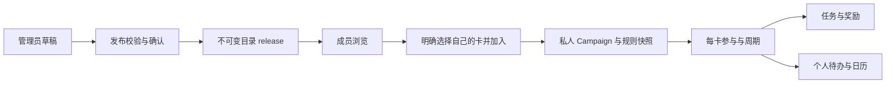

# 银行活动目录、管理员发布与个人加入架构

版本：v0.1<br>
设计日期：2026-10-09<br>
需求：[工作台 PRD 第 23 节](./PRD-WORKBENCH.md#23-管理员发布银行活动与成员查看2026-10-09)。<br>
关联：[活动与待办架构](./ARCHITECTURE-ACTIVITIES-TODOS.md)、[前端架构](./FRONTEND-ARCHITECTURE.md)、[数据库设计](./DATABASE-WORKBENCH.md)。<br>
状态：已提供共享类型和服务端端口骨架；真实鉴权、仓储、路由、发布及加入用例待实现。

## 1. 分工与实施框架

先由架构师确定数据归属、权限、版本、命令与查询合同，再由前端实现页面、组件、controller 和 API adapter。公共骨架与具体实现有独立交付边界：

| 责任 | 本轮交付或后续工作 |
| --- | --- |
| 架构师 | 本设计、共享 DTO/命令类型、服务端目录端口及个人加入 workflow 端口；复核接口和跨模块依赖 |
| 切图仔1 | 第 21、22 节既有前端拆分、私人活动/任务/奖励、待办列表/日历及相关验证 |
| 切图仔2 | 第 23 节成员活动中心、管理页面、规则表单、加入/规则差异交互，以及该功能所需的真实鉴权、目录 API/服务与联动实现 |
| 切图仔2 的后端依赖 | 角色持久化与校验、目录仓储/迁移、事务 workflow、系统事件消费、所有权及并发验证；个人端口按第 21、22 节合同接入，缺失时补齐最小闭环并记录范围 |

本轮骨架位置：

- [共享合同](../src/contracts/activity-catalog.ts)：发布/草稿分离的 DTO、规则模板、加入/采用命令及稳定错误原因。
- [目录公开端口](../src/modules/activity-catalog/ports.ts)：成员查询、管理查询/命令、当前权限检查。
- [加入与采用端口](../src/server/workflows/catalog-participation.ports.ts)：UnitOfWork、发布状态锁定、个人导入及公开用例。

这些端口暂未提供实现，也未注册真实管理或目录路由。类型检查只能证明骨架可集成，不能证明权限或持久化已生效。第 21、22 节的前端拆分已经开始；本轮复用其共享基础与 feature 结构。

## 2. 平台目录与个人事实

首版只建立全站登录目录，不引入 workspace、家庭或团队。`activity-catalog` 模块维护平台内容，`participation` 及其他个人模块继续维护 owner/card 链。

| 模型 | 所属模块与关键含义 |
| --- | --- |
| `CatalogActivity` | 平台目录：稳定活动 ID、银行统一 ID、批次键、发布可见性、当前 release 指针、当前 draft 指针、行版本 |
| `CatalogDraft` | 平台目录：可编辑内容、基于哪个 release、草稿版本；仅管理员可读 |
| `CatalogRelease` | 平台目录：不可变内容/来源快照、release 序号、内容哈希、发布时间、变更说明 |
| 私人 `Campaign` / `RuleVersion` | 用户活动：加入时建立个人定义与规则快照，显式引用来源目录 ID/release ID |
| `ActivityParticipation` | 个人参与：每卡独立，绑定个人规则快照及采用历史，资格/报名/进度不来自管理员 |

采用“目录引用 + 个人快照”的导入方式。现有数据库设计的 Campaign、RuleVersion 和 participation 用同一 user_id 复合关联；保留这条约束，在个人 Campaign/规则快照增加目录来源引用。不能直接让普通成员 participation 引用管理员所属的私人 Campaign，也不能用 nullable owner、管理员所有权豁免或删除复合外键来实现共享。

个人导入定义建议唯一键为 `(owner_user_id, catalog_activity_id, activity_instance_key)`；参与仍为 `(owner_user_id, private_campaign_id, card_id, activity_instance_key)`。`activity_instance_key` 在一个有限活动批次内固定，不随发布版本或日期修订变化。另一年度/另一活动批次建立新目录身份。原始导入引用与后续采用记录都保留，不能因采用新版本丢失最初加入证据。

目录只有内容信息，不保存成员卡片数组、消费、个人奖励或待办。成员查询中的 `myParticipations` 由查询层调用 owner-scoped 端口组合，只返回当前用户记录；管理查询没有成员参与清单。

银行标识使用独立 BankDirectory 的稳定 ID。现有卡片仅有 issuerName 文本，需增量增加可空银行引用或受控映射；无法确定的旧卡显示待核对，不能用模糊名称匹配确认资格。`myBanksOnly` 在服务端按本人已核对银行关联过滤，卡种/受邀/名额另行核对。



GET 浏览、筛选和预览均不写个人事实或待办；“我的银行”匹配只提供候选，不确认资格。

## 3. 身份与授权

平台角色为 member/admin，注册默认 member。管理员只增加 `catalog.manage` 能力，个人资源仍按自己 owner 身份访问。活跃登录账号拥有 `catalog.read`；停用、删除申请或无效会话无目录能力。

建议授权存储为服务端 `user_role_grants(user_id, role, version, granted_at, revoked_at)`。初始管理员由可信部署流程对已存在、有效的稳定 user ID 授权；不能让注册邮箱匹配某个配置后自行获得管理权。首版不开放角色授予/撤销的成员 API，运营撤销通过可信部署/管理流程写入授权存储。

每次管理查询和命令读取当前账号、会话及授权；命令在提交事务内再校验，角色撤销与管理写入使用同一授权行的版本/锁约束。只在登录时把 admin 写进 cookie/JWT、或只在页面入口校验，无法满足旧会话即时失权的验收。

`CatalogActor` 只能由真实会话认证构造。管理 API 不接受 JSON 中的 userId/role/capabilities，也不沿用 `x-user-id` 开发头作为管理员认证。前端 `GET /me/capabilities` 读取导航能力，403 时刷新该信息；此 DTO 只决定界面显示，不作为后端授权证据。

| 接口范围 | 授权与失败行为 |
| --- | --- |
| 成员目录 | 当前活跃会话 + 已发布可见性；草稿不进入成员 DTO |
| 管理目录 | 先校验当前 admin，再读取草稿/日志；普通成员统一 403 |
| 加入、采用、进度、奖励、待办 | 当前会话 + 自己的完整 owner/card 链；跨 owner 统一 404，admin 无豁免 |
| 已下架的个人来源 | 从当前用户已加入的 participation 读取绑定 release 和下架原因；没有个人引用的成员不能借此查看管理草稿 |

目录使用独立授权策略。不得修改现有个人资源查询为 `owner = currentUser OR role = admin`；成员个人导出/删除也不能删除或导出其他用户数据及平台管理草稿。

## 4. 草稿、发布与生命周期

发布可见性 `unpublished/published/withdrawn` 与活动时间阶段 `upcoming/ongoing/ended/cancelled` 独立。活动自然结束不下架；创建新版草稿时，当前已发布 release 继续对成员可见。

```text
创建目录草稿 -> 预览与核对 -> 发布 release 1
已发布目录 -> 基于当前 release 建新草稿 -> 发布 release 2
已发布目录 -> 记录下架原因 -> withdrawn，原 release 保留
```

发布检查必须在服务端执行：名称、统一银行 ID、明确有效期、已核对官方来源是发布必需项；日期顺序、IANA 时区、金额精度、目标表达式和引用也须有效。复杂规则保留原文、不执行代码；未知数量不填 0。官方没有明确时区时保存管理员确认的解释口径并展示，不能声称它是官方时区。

部分条件未知可以发布，服务器返回 `blocks_execution` 及醒目说明；缺少发布必需项返回 `blocks_publication`。前端确认未知项只表示已看到说明，不把未知事实改为已确认资格。

预览返回草稿版本、目录版本、内容 hash、问题列表。发布携带这三个核对依据和变更说明，并在同一事务中重新检查草稿/授权/来源，将内容冻结成 release、切换当前指针、追加发布历史、幂等结果、审计和 outbox。预览后内容被修改返回 409，重新预览，不能发布管理员未核对的新内容。新建草稿不虚构自身 expectedVersion；更新既有草稿和目录要求实际版本。

已发布 release 不允许原地编辑或硬删除。成员 DTO 不序列化 current draft、管理备注或管理日志；发布内容与 HTTP 缓存不能混用草稿查询，首版目录仍要求活跃登录。

## 5. 明确加入与同库事务

`POST /bank-activities/{id}/join` 是服务端 workflow，采用第 21、22 节的有限范围 UnitOfWork。顺序为：

1. 当前会话/账号校验；同键同参数的已提交请求返回原结果，同键改参数返回 409。
2. 在同一事务核对目录可加入状态、所选 release 和目录版本，并验证所有选择都是自己的卡；卡不合法则整个选择不写入，不能留下部分成功结果。
3. 调用私人 Campaign/rule 与 participation 的公开端口导入快照、幂等建立每卡参与。重复加入返回既有记录和 `created=false`，不把既有参与偷偷升级到新 release。
4. 逐卡核对私有账单边界、资格/报名/渠道/周期口径；明确的目标和日期才生成可执行计划。关键项未知时保存私人计划和核对行动，未知日期不进入日历。
5. 必要的当前条件投影、待办、未投递调度、幂等、审计及 outbox 一起提交。个人事实由所属端口写入，目录 repository 不直接写个人表。

普通响应返回参与 ID、绑定 release ID、个人版本/状态及失效范围。多卡身份互相隔离；采用新规则单独使用 adopt 命令，不通过再次 join 实现。管理员以自己身份加入也走相同 owner 校验。

大规模实例化按既有 job 契约返回 202 和 jobId，候选记录完整后统一激活；排队不能显示“已生成全部周期”。后台任务引用成员确认的个人计划版本及目录来源 release。目录发布新版不强迫该任务改为最新规则；激活围栏以私人计划版本、账号/卡状态和明确银行取消事实为准。下架后已接受的私人计划保留，显示核对/继续跟踪决定，不当作新的目录加入。

仅查看或加入不确认银行报名、个人资格、达标、领取或到账。活动结束后个人未领取奖励沿用自己的领取窗口；有来源的历史补记不能生成过期的“现在开始刷卡”动作。

## 6. 更新、采用、下架与取消

发布新版产生 `CatalogReleasePublished.v1`，payload 只含目录/release/变更信息。私人参与的更新提示由系统消费者经 owner-scoped participation 端口产生；管理员发布事务不读取各成员事实。跨成员扇出采用 outbox/inbox 与后台修复，每个用户的核对行动及其历史用本地事务提交。

更新核对行动唯一键为 `(owner, participation, target_release_id, review_catalog_update)`。读视图可根据当前 release 与绑定 release 展示“规则有更新”；后台尚未投递核对行动时显示对应处理状态。GET 不补写行动，多次事件、重试或重新聚焦都不生成重复待办。

成员先查看 diff，再提交 adopt：

- 指定目标 release、participation expectedVersion、明确选择的未来 period ID 及变更说明。
- 未启动且无消费/确认事实的未来周期可更新计划，稳定周期/行动 ID 保持；生效时间及未完成调度一起修订。
- 当前周期须明确选择“保留冻结规则”或“创建待核对修订”；后者追加原/新规则与决定，保留旧确认及原始消费，不覆盖目标历史或消费金额。
- 旧已结束周期、奖励领取及到账事实不随规则采用重写；原导入版本、采用版本和每期实际版本均可追溯。

目录下架在同一目录事务记录原因/历史并关闭新 join。与 join 使用同一发布状态锁或等价并发约束：下架先提交后新 join 必须失败；先已提交的私人参与保留。下架事件生成稳定的核对行动，成员选择继续跟踪或停止未来计划；不自动把参与设为银行取消、奖励失败或到账撤回。

银行确认取消通过带官方证据的发布内容 `bankCancellation` 单独表达，不能从目录下架推断。所属个人模块停止新的消费动作并核对既有奖励，保留绑定快照/历史；事件扇出未完成时新激活/消费提醒命令也检查当前已确认取消事实。停止通知不删除待领取记录。

## 7. API 合同

以下路径统一加 `/api/v1`。新增查询返回 `{ data, meta }`，沿用 `QueryMeta` 的 serverNow/timezone/asOf；普通命令返回已提交数据，工作量大时返回既有 queued/job wire 合同。骨架中的 `CommandResult` 为 adapter/用例结果，HTTP 202 body 仍是 `{ data: { jobId, status: "queued" }, meta }`。

| 路径与方法 | 范围与职责 |
| --- | --- |
| `GET /me/capabilities` | 当前会话的目录阅读/管理能力、授权版本；不暴露角色写入口 |
| `GET /bank-activities` | 成员发现列表；银行/类型/关键词/阶段/myBanksOnly/joinedOnly/cursor |
| `GET /bank-activities/{id}` | 当前已发布详情；私人来源的下架旧版本通过自己 participation 读取 |
| `GET /bank-activities/{id}/releases/{releaseId}` | 该活动曾发布的规则版本；验证所属活动和可见性，不读取 draft |
| `GET /admin/bank-activities`、`/{id}` | 管理列表、草稿/发布记录与管理历史 |
| `POST /admin/bank-activities` | 创建新目录及初始草稿 |
| `POST /admin/bank-activities/{id}/drafts` | 从当前 release 建立修订草稿，要求目录版本 |
| `PATCH /admin/bank-activities/{id}/drafts/{draftId}` | 更新指定草稿，要求草稿版本 |
| `GET /admin/bank-activities/{id}/drafts/{draftId}/preview` | 只读成员视角预览及发布校验 |
| `POST /admin/bank-activities/{id}/publish` | 版本/hash 再校验与发布；需要 changeNote |
| `POST /admin/bank-activities/{id}/withdraw` | 下架并保留 reason 与历史 |
| `POST /bank-activities/{id}/join-preview` | 只读校验所选卡和私人边界，返回目录版本、待核对项、已有参与 |
| `POST /bank-activities/{id}/join` | 显式加入，多卡原子校验与私人快照导入 |
| `GET /activity-participations/{id}/catalog-source` | 自己参与的绑定发布内容、版本来源与下架信息 |
| `GET /activity-participations/{id}/catalog-diff?targetReleaseId=...` | 自己参与的原/新版本与影响范围 |
| `POST /activity-participations/{id}/adopt-catalog-release` | 用户确认采用、追加当前期修订或更新未来周期 |
| `POST /activity-participations/{id}/catalog-tracking-decisions` | 针对 noticeId 记录继续/停止未来跟踪和奖励通知策略，要求个人版本 |

目录查询只返回发布内容；个人活动接口 `/campaigns` 和 `/workbench/activities` 继续表示私人定义与参与，不混入管理草稿。目录历史版本使用 `readRelease` 端口，核对目录归属与可见性。个人详情通过可选 `CatalogParticipationSource` 展示最初/采用/当前目录版本、下架原因和跟踪决定，不能退化成任意 source ID 读取。

命令的 Idempotency-Key 绑定当前 actor、用例及请求 hash。所有权失败统一 404；管理权限失败 403；版本/hash 冲突 409；发布必需项不完整或当前目录不可加入使用 422。沿用现有顶层错误码，在 details.reason 返回 `CATALOG_VERSION_CONFLICT / CATALOG_NOT_JOINABLE / DRAFT_CHANGED / PUBLICATION_BLOCKED / PERIOD_REVISION_REQUIRED`，不悄悄增加另一套错误 envelope。

## 8. 前端框架与页面

新增成员 `/bank-activities`、详情 `/bank-activities/{id}`，管理 `/admin/bank-activities`、新建及编辑/预览路由；私人 `/activities` 继续展示当前用户的参与。全站导航增加“银行活动”，管理员按 capabilities 增加管理入口；401/403 均有明确状态。

| feature | 组件/controller 与边界 |
| --- | --- |
| `activity-catalog` | CatalogFilters/List/Detail、JoinActivityDialog、JoinPreview；只读取目录和提交用户加入意图 |
| `catalog-admin` | AdminCatalogList、DraftEditor、MemberPreview、PublishDialog、WithdrawDialog；不持有成员个人事实 |
| `activity-rules` | 纯周期/奖励/来源模板字段与校验展示；公开组件供私人编辑和管理编辑复用，不发请求/拥有报名结果 |
| 既有 `activities` | 个人参与、CatalogRuleDiffPanel、AdoptReleaseDialog、绑定版本/下架原因/跟踪选择 |

页面层组合卡片选择和参与跳转；新增 feature 通过自己的 adapter/controller 使用共享 DTO。所有 UI 接收服务端权限和校验问题，不从管理员身份推导个人资格。

管理员草稿、成员已发布结果使用不同查询身份和 adapter；退出/撤权清空管理结果。发布成功刷新目录和管理详情，不把草稿写进成员缓存。加入成功失效个人活动、首页、待办/日历以及目录的 myParticipations；规则采用同时失效任务/奖励。失效类别见 `CatalogResource`，接入时扩充既有前端失效机制，避免在根 provider 存放目录和所有私人实体。

## 9. 数据库与发布依赖

新增角色授权、银行统一目录、目录活动、草稿、不可变 release、发布历史、私人来源映射/采用历史。目录表不伪造 owner；角色服务拥有授权表。release 外键使用 restrict/等价保护被引用历史，目录下架用状态字段，不硬删除。私人 Campaign/RuleVersion 的新来源引用与现有 owner FK 同时存在。

加入唯一键、发布行版本、草稿 hash/版本、引用 ownership、不可变 release、source snapshot 和审计/outbox 必须有数据库约束或受控写端口证据；内存端口只作为开发/测试夹具。系统消费者按已存的 owner 范围处理私人动作，不允许管理员请求模拟任意 owner。

删除用户清理私人引用和事实，保留平台内容；平台发布审计中的操作者引用按既有账户删除/匿名化政策保留可审查事件，不级联删除公开 release。个人导出包含自己的导入/采用证据，不包含管理草稿或其他成员信息。

依次接入当前会话能力/授权与目录持久化 → 管理草稿/发布 + 成员只读 → 私人加入最小周期 → 多周期 + 更新采用/下架。新增 feature gate 至少区分 `catalog_read`、`catalog_manage`、`catalog_join`；管理不能早于真实鉴权，join 还依赖第 21、22 节的个人事实、TodoAction 和 job 真实闭环。正式入口在各自后端和前端验收通过后开放。

## 10. 第 23 节验收追踪

| PRD 23.7 | 架构责任与验证证据 |
| --- | --- |
| 1 | 注册默认 member、无自助提权字段；直接管理接口 403，草稿不进入成员 DTO |
| 2 | 单管理员发布/新版草稿隔离；两个有效账号读取同一已发布 release、官方来源可达 |
| 3 | 必需项缺失阻止发布；未知项可发布但个人任务激活受限，数值不填造值 |
| 4 | 两成员 owner/card 链隔离；管理员读取他人参与/任务/奖励/待办也是 404 |
| 5 | GET/preview 无写入；join 同键重试/新键重复/并发多卡不双建，30/7/1 通知只关联一条行动 |
| 6 | 加入不写银行确认；私人边界未知只存计划/核对行动，无虚假日期或确定进度 |
| 7 | diff/用户采用/当前期修订可追溯；旧消费不覆盖，事件重复只一条版本核对行动 |
| 8 | join/withdraw 并发围栏；已加入版本与原因仍可读，结束后领取窗口内奖励仍可处理 |
| 9 | 旧会话撤权及撤权/发布并发；发布/更新/下架审计保留 actor、版本、时间和说明 |

需补充真实 API/数据库/worker 测试及 360px、键盘、焦点、未知值、权限撤销、冲突和 queued 失败恢复的前端验收。骨架类型检查与文档追踪通过，不替代这些功能验证。

## 11. 实施任务 CC-23 与共享工作区边界

用户授权第 23 节具体实现交给“切图仔2”。按权限/目录持久化与只读查询 → 草稿/预览/发布/下架 → 显式加入个人卡片 → 差异采用/跟踪决定与待办联动执行。完成阶段需提供可运行路径及相应验证证据。

优先独立新增 `app/bank-activities/`、`app/admin/bank-activities/`、`src/frontend/features/activity-catalog/`、`catalog-admin/`、`activity-rules/`、对应页面目录及 `src/modules/activity-catalog/` 服务/仓储、增量 migration、workflow 和测试。共享 DTO 和本轮端口为起点，必要扩充保持原合同兼容。

切图仔1正在修改原有 AppShell、Workbench、共享 query、私人活动及待办 feature。切图仔2先以独立模块和端口推进，接入共享导航/失效/个人详情时按当前文件内容做最小兼容追加，不覆盖、重置或整体替换其未提交实现。原 PRD 与架构由各自负责人维护，不借实现改写验收范围。

第 23 节不能以只有 mock 的页面代替真实权限/发布能力。第 21、22 节个人后端端口缺失时，可按既定架构补齐加入需要的服务端最小闭环；依赖尚未具备的阶段保留明确 gate 和问题清单。生产持久化/并发/恢复未验证的范围要如实记录，个人事实与入口不得被声称已经完成上线验收。

交付记录包括改动文件、管理员/成员的本地复现方法、执行检查及结果、PRD 23.7 的 9 项映射、与切图仔1代码的接口兼容情况和剩余依赖。此任务不要求自动提交、推送或发布。
