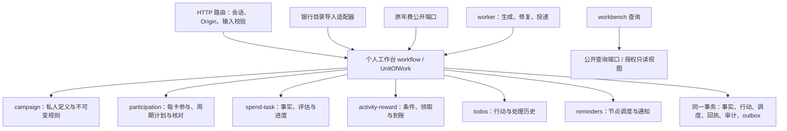

# 第 21、22 节后端补齐架构与实施合同

版本：v1.0。日期：2026-10-13。负责人：架构师；实施负责人：后端仔。

状态：设计已确定，后端已领任务；本文不表示接口已实现或功能已开放。范围依据 [PRD §21、§22](./PRD-WORKBENCH.md)，沿用 [活动与待办领域架构](./ARCHITECTURE-ACTIVITIES-TODOS.md) 的业务原则。本文件补充基于现有代码、迁移 0000—0006 和前端实际请求的实施决策；此前设计与实际代码不一致时，按此处的增量合同实施并保留兼容。

## 1. 问题及交付目标

当前普通账户的新入口未开放；`/dev/workbench` 使用前端示例数据。第 23 节已经实现了目录活动导入、累计观察、奖励结果和目录待办的最小持久闭环，但不是第 21、22 节完整后端。

| 已核对的代码 | 现状及缺口 |
| --- | --- |
| `src/server/catalog/private-http.ts` | 个人接口通过 `CatalogService` 创建运行时，全部依赖 `FEATURE_CATALOG_JOIN`；年费和自定义待办不应依赖该开关。 |
| `db/migrations/0005_catalog_personal_import.sql` | 私人活动定义/规则必须有目录及 release；待办必须有 card/participation；不能表达自建活动、年费待办或不关联卡片的自定义待办。 |
| `src/modules/participation/catalog-import.ts` | 每期报名、全期独立目标还会阻止执行；自然月生成存在 120 期截断。 |
| `catalog-queries.ts` / `catalog-commands.ts` | 当前是目录规则、每周期一个累计任务；详情 `plan=null`，没有完整私人规则/计划编辑、逐条消费关联及退款账本。 |
| `app/api/v1/todos` | 只有 GET 和 actions，没有自定义 POST/PATCH；现有查询声明 `coverage=catalog_only`。 |
| `src/modules/fee-events/service.ts` | 年费事实、提醒取消和审计分别写入，尚未与统一行动共享事务。 |
| `src/frontend/features/*/api` | 已发出私人活动、计划、节点偏好、自定义待办、消费事实和 job 请求；存在 adapter 不等于对应路由已实现。 |

交付结果：普通成员使用真实会话，可创建私人活动、生成有限周期、维护进度与奖励；年费、活动、自定义待办出现在同一列表/日历，保存后立即读取已提交结果；重新启动服务和 worker 不丢事实、不重复生成行动或通知。私人活动与银行目录可分别关闭入口。

## 2. 模块与分层

继续采用同一应用、同一数据库的模块化单体。扩展已经存在的私人模型，不新建一套 `manual_*` 活动表或第二套待办表。

| 层/模块 | 实施责任 |
| --- | --- |
| `src/server/workbench` | 个人运行时与 HTTP facade。真实会话、功能能力、参数校验、响应封装；不写领域表。 |
| `src/server/workflows` | 用例编排、同一事务、幂等、影响范围；提供私人工作台与年费接入流程。 |
| `src/modules/campaign` | 扩展 `private_campaigns/private_rule_versions`；私人来源、定义版本和规则版本。 |
| `src/modules/participation` | 复用参与和周期表；有限计划、稳定周期身份、资格/报名/名额、取消及历史。 |
| `src/modules/spend-tasks` | 快照/逐条模式、同源消费、任务评估、阶段与退款。 |
| `src/modules/activity-rewards` | 奖励依赖及独立事实轴；复用 `activity_rewards/activity_reward_events`。 |
| `src/modules/todos` | 同一行动表、节点偏好、人工处理、年费源适配、自定义待办。 |
| `src/modules/reminders` | 年费旧调度的兼容关联、新节点通知调度和投递。 |
| `src/modules/workbench-query` | 按卡活动、组合详情、待办分组、日历和首页聚合。 |
| `src/shared/db` | 事务连接和仓储适配。旧年费仓储增加绑定当前事务的入口。 |

模块只通过公开端口协作。`PersonalCatalogService` 保留为目录导入兼容 facade，公共个人服务不能持有 `CatalogService` 或读取目录仓储。来源端口返回 `manual` 或 `catalog` 的受控联合类型；只有 catalog 分支调用目录公开端口，检查发布版本/官方取消等原有约束。普通 GET 不生成周期、待办、规则或奖励。

## 3. 共用模型与追加迁移

从 0006 后追加顺序迁移；不能修改已应用的 0004—0006。DDL 名称可由实施者按仓库序号确定，但以下事实和约束必须保留。

### 3.1 活动定义与规则来源

- `private_campaigns` 增加 `origin_kind=manual|catalog`、定义版本、名称及创建/更新时间。既有行回填为 catalog，保留 UUID 和活动批次 UUID。
- manual 的目录 ID、初始 release 均为空；catalog 两者均非空并保留原复合外键。增加分支 CHECK，不能以放松外键允许半个目录来源。
- 首版一个 campaign 对应一个逻辑 rule，`ruleId=campaignId`，与现有查询字段兼容。不可变版本继续使用 `private_rule_versions.id`，增加真正的 `version_no` 和来源快照；不能继续把 participation 的 version 当作 ruleVersion。
- manual 内容按独立私人规则 schema 校验；目录内容经过导入适配。目录已有 `content` 保持与原 release 完全一致，保留 `private_catalog_rule_scope` 的校验。manual 不伪造银行 release，也不要求具备管理员发布资格。
- `private_catalog_rule_scope` 升级为按来源分支校验：manual 校验归属及私人规则，catalog 校验目录/release/原始内容；规则内容仍不可变，只能追加新版本。
- 版本号等新增元数据在迁移事务中回填，处理原 `private_rule_no_rewrite` 触发器后立即恢复不可变保护。逐行比较原 ID、release、content 和引用，禁止借回填改写规则事实。
- source/rulesText 可不完整；`rewardText` 仅保存原文，不从自然语言猜金额、领取方式或全期条件。结构化奖励通过独立奖励命令配置。

目录来源的私人规则首版仍通过 adopt 流程更新，不能用私人规则编辑端口改写目录快照。未来若需要个人覆盖，必须新增显式来源类型和决定记录，不隐式改变本合同。

### 3.2 参与、计划、核对与任务

- 沿用 `(owner, campaign, card, activity_instance_key)` 唯一参与，稳定身份不含日期或规则版本。`activity_instance_key` 的存储类型仍为 UUID，由服务端活动定义分配。
- 当前前端传入的 `activityInstanceKey=命令键后缀` 是不透明客户端请求标识，facade 记录/校验它并映射到 campaign 的固定批次；不能直接强转为 UUID，也不能用每次重试的新键建立第二个批次。
- 增加 `period_plan_revisions`、生效计划引用及生成状态。已有 `activity_periods` 回填可追溯的 legacy plan，保留 period/task/reward/action UUID；不从观察推算原计划或官方确认。
- 周期增加计划引用与固定的规则快照；父链校验包含 owner/card/participation/campaign。周期和规则均须属于该参与的 campaign，不能只分别满足两个独立外键。
- 活动生命周期、跟踪决定、规则待核对、报名/资格/名额是不同维度。新增按 `participation|period` 区分的核对记录及报名尝试；每期序号按自己的 scope 递增。
- `spend_tasks` 增加 `scope=period|overall`、稳定 task_key、模式及冻结计算规则。period 任务必须引用本参与周期；overall 的 period_id 为空，具有自己的完整有限区间和目标。替换原 `unique(period_id)` 为正确的任务业务键，保留已有任务身份。
- `activity_rewards` 的固定条件依赖使用受约束的关联表，分别引用某期任务、确定的 required_period_ids 或整体任务；取消某期不能偷偷缩小最终奖励的分母。

### 3.3 统一行动与日期节点

扩展现有 `todo_actions`：增加 `source_kind=annual_fee|activity|custom`、年费来源引用、说明、优先级、处理来源及必要时间/历史字段。card_id、participation_id 按来源可空，配合约束，不单独删 NOT NULL 后让任意对象混入。

| source_kind | 必须引用 | 允许为空 |
| --- | --- | --- |
| annual_fee | 本用户 FeeEvent 及该 FeeEvent 的卡；稳定 key `annual_fee:{feeEventId}:resolve` | participation |
| activity | 经校验的参与及具体周期/任务/奖励节点，沿完整父链引用 | 不需要的子资源 |
| custom | owner 及自定义 action 身份，`custom:{actionId}` | card、全部业务来源 |

为 FeeEvent/卡/参与/任务/奖励补充必要的复合 UNIQUE/FK。系统 source 不接收任意 `objectType+UUID`。自定义编辑不能把系统行动转成 custom，也不能改 owner/source/card 的业务父链。

新增 `business_date_nodes` 存放经源领域投影的日期节点及独立展示/通知偏好：owner、受约束来源、稳定 node_key/node_kind、DateValue、源版本、展示与通知配置。源领域拥有业务日期；节点是其投影。活动起止、领奖起止与预计到账各有独立节点。

- 有行动时 `todo_actions` 关联节点；列表与日历引用同一个 action ID/version。
- 仅日历展示或仅通知时可以只有节点。marker 不能完成，不以隐藏的伪待办代替业务日期节点。
- 同一节点已有可展示行动时不再输出重复 marker。原隐藏行动和全部处理历史保留；切换偏好不能删历史或重建已存在的 action ID。
- `todo_notification_schedules/todo_notifications` 增加节点引用，允许没有 action 的合法节点通知；至少有一个有效节点/行动引用，同时存在时必须在同一 owner/source 链。
- 年费 `reminders` 增加行动/节点关联并保留原 ID/处理状态。年费仍由旧年费调度所有者投递；新节点调度器不再为同一年度节点建立第二套通知。活动/自定义调度由新节点调度器拥有，所有者互斥。

现有目录 action_key 保持不变；唯一约束继续为 `(owner, action_key)`。历史版本和手动处理状态不是可随意重建的缓存。

### 3.4 消费事实及可恢复任务

新增 owner/card 归属的 `spend_facts`、阶段里程碑/冲正事件、`spend_task_evaluations` 和评估修订。每任务 `(owner, fact, task)` 只出现一个逻辑评估；事实不因关联月度与 overall 任务重复入账。退款累计不得超过原金额，各受影响任务按自己的冻结规则重放。

新增 `personal_workbench_jobs` 与 `period_plan_candidates`。job 绑定 owner、participation、候选计划、基础版本、输入 hash、进度、attempt/lease、错误及结果；候选表不参与正常活动、待办、日历或通知查询。投影/outbox/inbox 复用可通用的现有设施，事件命名增加私人/年费类型；无需另造通用 operation 平台。

## 4. 一致性、幂等与版本

所有私人命令使用统一 `Actor={userId, sessionId}` 和 `CommandContext={actor, idempotencyKey, requestId}`。从 Cookie 查真实有效会话，在事务内再次确认账户未删除、会话未撤销；普通成员操作个人资源不查询管理员 grant。

公共端口接收同一个事务上下文，不能另开连接提前提交。当前目录仓储的会话/事务/幂等实现提取为共享设施，`CatalogRepository` 保留 facade；目录特有授权留在目录模块。幂等存储可以先复用 `catalog_command_results` 物理表，由公共端口访问并使用分区 command_scope，禁止复制一套相互独立的回执逻辑。

同一事务提交：业务事实 → 本次影响的任务/奖励条件 → 当前行动及节点 → 未投递调度修订 → 幂等结果/审计/outbox。确认一个奖励到账只完成该奖励的到账核对；完成待办只调用 todos/reminders，不写奖励到账、资格、报名或年费事实。

锁顺序兼容现有归档：会话/用户 → 目录源围栏（仅目录分支）→ 卡 → campaign/participation → plan/period → task → reward → node/action → schedule。同类按 ID 排序；目录发布/加入/下架继续保留原来源锁协议，私人重构不得另加逆序获取。账户清理、退款和 worker 必须采用同一受影响链协议。

- 幂等键按 owner+command_scope+key 唯一，存规范化请求 hash 和已提交响应。相同请求重放相同结果，键不允许换请求内容。
- 相同键并发只执行一次；回执优先于重放中的旧 expectedVersion 校验，响应丢失后允许安全重试。先重新鉴权，不让已撤销会话读取回执。
- 既有对象修改检查 expectedVersion；ruleVersion、participationVersion、planVersion、taskVersion、rewardVersion 分别有自己的含义，不共用一个计数。
- `ActivitySummary.ruleVersion` 表示不可变规则序号，`activity.version` 表示参与状态版本；GET 返回 editorDraft、真实 plan、可操作原因，不能用 catalog participation.version 充当所有版本。
- 冲突返回 409 和可重查信息，保留草稿；所有权失败统一 404；缺失/无效的可修复规则、边界、来源状态返回 422。服务端重新检查可操作性。

旧年费 service/repository 增加事务绑定端口。`fee_event.status_updated`、待办关闭/明确恢复、旧提醒取消及审计必须在同一事务；不能把几个 await 称作原子操作。

## 5. 私人活动、周期与奖励用例

### 5.1 两阶段创建与规则编辑

保持现有 activitiesApi 两阶段请求：定义创建使用 `key:definition`，参与创建使用 `key:participation`。每阶段自身幂等、已提交；两个 HTTP 请求不能承诺一个数据库事务。

定义成功不自动创建参与、消费任务或确认资格。参与失败后可用原命令键重试；`GET /campaigns?unjoined=true` 可读取本用户未加入定义并恢复流程。列表只展示已存在的参与；未加入定义不能进入公开目录。

私人规则编辑追加不可变版本，更新明确当前卡参与的后续计划默认规则；既有 period/task/reward 保留各自冻结引用。没有选择范围的规则保存不自动改期。实际周期采用由 period-plans 命令执行，受影响集合须明确；其他卡参与不跟随修改。当前页面已取得完整 editorDraft 才开放编辑；目录来源继续使用 adopt，私人编辑不能绕过目录来源约束。

### 5.2 有限计划及修订

四类周期：month 按本地自然月切分；billing/custom 要求明确边界；once 覆盖完整活动区间。存储包含端点日期 `[startOn,endOn]`，相邻周期不能共含一天。不能用固定 24 小时计算本地日，不能仅凭账单日猜完整账单周期。

目标支持 count/amount/AND/OR。金额使用数据库 numeric 或精确十进制运算，API 为字符串。复杂条件保留原文和待核对原因；首尾不足期政策未知可保存候选计划但不宣称确定达标。不按天折算、不把超额结转到下一期。

`affectedPeriodIds` 校验同用户/卡/参与，只允许尚未启动且无消费或确认的未来期采用新修订。相同周期逻辑身份保持原 ID；调整有事实的当前/历史周期必须走显式修正及核对记录，普通计划编辑返回 422。删除/取消周期保留历史和奖励原依赖。

单次小计划同步提交；初始同步预算为不超过 48 个周期且 256 个受影响节点，可根据实测调整并写入交付记录。超过预算走 job。超过支持的硬上限明确返回 422 及上限，绝不保留现有“生成 120 期后静默 break”的行为。

### 5.3 进度与奖励事实

- 同一任务有记录后固定 snapshot 或 entries；禁止把累计快照与逐条评估相加。模式迁移是显式迁移/核对用例，不开放一个无审计切换按钮。
- 预计与确定进度按冻结 occurred/posted/settled 口径区分；历史 unknown 阶段保留待核对，不伪造入账。金额/日期相同不能自动认定重复消费。
- overall 是独立任务；快照模式保存自己的全期观察，不以月度达标数量或不兼容月度快照相加替代。
- 报名/资格/名额按真实 scope 查询；本期确认不覆盖下期。新增 `record_quota`，enum 使用可追踪的未知/已确认/不满足，未知不能映射成默认通过。
- 奖励分别支持 period、固定 all_periods、overall 依赖；目标达到、官方达标、条件齐备、领取提交、领取确认、实际到账独立。
- automatic 不生成领取行动；manual 未到窗口禁用当前领取。补记历史外部结果保留发生时间/录入时间，不能把当前已关闭窗口显示为可领取。
- 部分到账只减少该组件剩余量；未知总量不能填 0 或推断全部收到。退款导致条件失效时保留此前确认、转待核对，不自动撤回已到账事实。
- 活动自然结束保留待领取；取消活动/归档卡停止新增消费，keep/stop 只决定后续奖励提醒，历史核对/领取结果/实际到账仍可记录。

## 6. 第 22 节待办、日历及年费接入

年费回填根据 FeeEvent，不能根据旧提醒 completed 推断业务已处理。pending 生成待处理行动；明确 waived/charged/refunded/not_applicable 完成该年费处理节点。年费恢复 pending 必须通过显式事实修订与历史记录处理，不能被日常 reconcile 偷偷复活。

30/7/1 天提醒均关联一个稳定年费行动。新的年费事件创建、卡片年费日期修改、年费状态命令、周期重算和后台 reconcile 都通过同一源适配端口更新。无关进度变更不复活人工完成/忽略的待办；旧已投递/已处理通知保持原历史。

完成/忽略/恢复/延期使用现有 TodoCommand。人工完成只代表处理行动；业务关闭记录 `completionOrigin=business`，人工处理记录 manual。新的明确证据让已核对结论失效时允许有原因地重新打开核对行动；普通重建不覆盖人工状态。

自定义 POST/PATCH 校验标题、说明、可选本人卡、DateValue 和 normal/important。PATCH 只允许 custom，版本冲突不覆盖；无卡查询必须使用 LEFT JOIN，不能因原 `join cards` 丢记录。首版自定义不支持子任务、附件或通用重复；通知未选择则不排调度。

列表/日历/attention 使用同一查询过滤器：cardIds/types/status/q/from/to/includeUndated，日历增加 month。分组按 deadline、否则 plannedFor：overdue/today/明日至第七天/later/undated。同组截止升序、重要优先、创建顺序/ID 稳定排序；完整筛选计数独立于分页项目数量。

日期原值沿用 DateValue：date/instant/unknown。date 截止的有效窗口结束于指定 IANA 时区次日本地午夜；instant 只有越过明确截止时刻才算逾期，测试截止前、相等、后一毫秒。未知日期只计入列表和 undatedCount。延期不修改硬截止，不影响逾期分组。

每次组合查询使用一致读取事务，同时取得项目、计数、serverNow/timezone/asOf/nextBoundaryAt。asOf 固定翻页的时间分组基准，不宣称跨 HTTP 数据快照；游标绑定 owner、筛选及稳定排序位置，不能拿其他账户/筛选游标读数据。业务可操作性仍按当前服务端时间检查。nextBoundaryAt 包含本地跨日及即将到来的精确窗口边界。

日历只读节点和行动；marker 没有处理命令，无日期行动不造日期；已有行动的日期、状态、ID/version与列表一致。attention 默认最多 5 项，total/count 表示完整符合筛选集合。达到全覆盖前继续 `coverage=catalog_only`、`canCreateCustom=false`；真实年费、自定义和活动均接通后移除该限制或扩为明确的 complete，不能提前宣称全覆盖。

## 7. 对现有前端的接口合同

所有路径以 `/api/v1` 开头。普通 GET 为 `{data,meta}`，普通命令为同样 envelope，由当前 `apiCommand` 解包为 committed；不能在 wire response 再套一个不同的 kind/data 层。只有 job 返回 HTTP 202：`{data:{jobId,status:"queued"},meta}`。

| 路径 | 输入/返回及兼容决定 |
| --- | --- |
| POST `/campaigns` | 接受现有 ActivityDraft；返回 `{id,version}`。cardId 是创建上下文并校验所有权，不在此步骤建参与。 |
| GET `/campaigns` | 私有定义/未加入草稿及可重试上下文，不展示其他成员或未发布目录草稿。 |
| POST `/campaigns/{id}/participations` | `{cardId,campaignVersion,activityInstanceKey}`；返回 ActivitySave，含 participationId/ruleVersionId/invalidated。 |
| POST `/rules/{id}/versions` | ActivityDraft+expectedVersion，ruleId 为 campaignId；追加版本并返回 ActivitySave。既有周期保持引用。 |
| GET `/workbench/activities` | 沿用 ActivityFilter/ActivityList，批量读取摘要及 currentPeriod/rewards/nextAction，避免逐卡逐周期 N+1。 |
| GET `/workbench/participations/{id}` | ActivityDetail：真实 plan、版本、editorDraft、各 scope checks、nodePreferences、overallTasks 与历史；manual 没有 catalogSource。 |
| POST `/activity-participations/{id}/actions` | eligibility/quota/cancel 等；scope=period 时必须带合法 periodId；cancel 接受现有 keep/stop 并归一化 continue/stop。 |
| POST `/activity-participations/{id}/enrollment-attempts` | 独立 scope 的追加尝试/结果，返回 ActivityCommit，重试不覆盖另一周期。 |
| POST `/activity-participations/{id}/period-plans` | 现有 PeriodPlanDraft；ruleVersionId 必须可用于该参与，participationVersion/expectedVersion 分别检查。同步 ActivityCommit 或 202。 |
| GET `/activity-participations/{id}/periods` | 周期及稳定版本，既有详情可继续批量包含。 |
| GET/PUT `/activity-participations/{id}/action-node-preferences` | PUT 为 `{nodePreferences,expectedVersion}`；节点独立设置，拒绝未知节点类型及无效通知天数；返回 ActivityCommit。 |
| GET `/spend-tasks/{id}` | 原 SpendTask，periodId 可空表示 overall；mode/阶段/allowedCommands/canLinkFacts 都由真实后端能力决定。 |
| POST `/activity-participations/{id}/spend-entries` | SpendDraft+taskVersion+evaluateTaskIds；原始事实一次保存并校验全部目标任务，失败整体回滚。 |
| POST `/spend-tasks/{id}/evaluations` | `{spendFactId,expectedVersion}`；引用同 owner/card 事实和目标自己的规则，返回 SpendWrite。 |
| POST `/spend-entries/{id}/milestones`、`/reversals` | 追加入账/清算或退款、期望版本、实际时间/依据；返回事实和受影响任务版本，新增合同须列入后端交付。 |
| POST `/spend-tasks/{id}/observations`、`/qualification` | 保留现有阶段和 scope 字段；累计/人工确认分别处理，返回 SpendWrite。 |
| GET/POST `/activity-participations/{id}/rewards` | GET 仍返回 Reward[]；POST 接受现有 RewardDraft，约束 period/all_periods/overall 依赖，返回 RewardWrite。 |
| POST `/activity-rewards/{id}/claim-attempts`、`/receipt-events`；POST `/reward-claim-attempts/{id}/results` | 保持现有前端字段与独立事实链，版本及所有权重新校验。 |
| GET/POST `/todos`、GET/PATCH `/todos/{id}`、POST `/todos/{id}/actions` | GET 为 TodoList/TodoAction；POST/PATCH 使用 CustomTodoDraft；命令 TodoCommit。新增真写能力后才 canCreateCustom=true。 |
| GET `/calendar-entries`、`/workbench/attention` | TodoCalendar/TodoList，来自同一行动及节点查询。 |
| GET `/todo-notifications` | owner 内的统一节点通知历史；旧 `/reminders` 继续年费兼容读。前端通知历史接入缺口必须在交付中列明。 |
| GET `/jobs/{id}` | 原 Job DTO，owner 校验；queued/running/succeeded/failed、progress/message/retryable 来自持久任务。 |

当前 ActivityDraft 不包含结构化多奖励、每期报名范围/名额和精确活动时间；基本录入只保存明确字段，其余保持 unknown。需要补这些写入能力时使用兼容可选字段或独立命令，列出 schema、版本及必要前端 adapter/UI 改动。后端不得假称现有表单已提供全部需求输入。

公共 DTO 保留现有字段；补强命令可新增 optional sourceKind/enrollmentScope/明确 DateValue 等，不把原 required 字段突然改名。同步 success 的 invalidated 至少覆盖此次影响的 activities/spend-tasks/rewards/todos/notifications；年费还包括 annual-fees/cards。

## 8. job、worker 与历史恢复

POST period-plans 的幂等回执保存 candidate/job 身份。同 job 的同输入重放不新建任务；failed 时通过现有 `retryJobId` 恢复相同候选，使用新的命令键，校验 owner、kind、输入 hash 和基础版本，增加 attempt/lease。改变输入必须新修订；旧 worker 不能激活新 attempt。

worker 分批写候选数据、检查周期/任务/奖励依赖完整性。完成时锁参与及目标未来周期，重新校验基础版本、用户/卡状态和冻结范围；单事务用批量 SQL 合并候选、更新行动/调度、切换生效计划并将 job 标记 succeeded。候选失败或版本冲突保留旧计划，正常查询不能看到半套周期或新旧混合日历。

任务 lease 过期可续跑，阶段写入按稳定业务键去重。消费者记录 inbox/源水位，忽略晚到旧版本。通知投递在锁定源节点/行动/调度后重新检查会话无关的账户状态、卡状态、奖励 keep/stop、日期版本及延期，过期旧调度取消，已投递历史不重写。

worker 注册 personal.periods.reconcile、todo.reconcile、personal.notification.dispatch；目录事件派发仍单独受目录开关控制。公共任务读已有持久记录不依赖 FEATURE_CATALOG_JOIN；关闭新写时停止生成并取消不允许投递的 pending 调度，保留查询和历史。账户删除优先关闭生成/投递，随后清理节点、行动、事实、评估、job/候选、outbox/inbox、参与及定义；清理后重放不得复活。

JSON 导出增加版本及私人活动、计划/核对/消费事实/奖励/待办/通知/job 结果，保留原年费内容及目录来源。只导出本用户业务数据；账户清理覆盖无卡自定义待办和未加入定义，不能只遍历 cards。

## 9. 开关与正式入口条件

| 能力 | 后端门控 | 可开放前提 |
| --- | --- | --- |
| 年费+自定义+现有活动待办 | `FEATURE_TODOS` | 同一查询全覆盖、真实自定义写、年费源同步、旧提醒去重/历史通过。 |
| 私人定义、参与和最小活动闭环 | `FEATURE_ACTIVITIES`，依赖 todos | 无需目录 join；真实创建/规则修订/核对/奖励读写通过。 |
| 多周期、逐条关联、整体任务与 bulk | `FEATURE_ACTIVITY_PERIODS`，依赖 activities | 有限周期/冻结历史/退款回放/候选激活/worker 恢复通过。 |
| 目录读/管理/加入 | 原 `FEATURE_CATALOG_READ/MANAGE/JOIN` | 保持目录来源/角色及原发布/下架/采用约束。 |

个人待办开放可以完全关闭目录；关闭目录发现入口不应隐藏已加入的个人历史和奖励核对。个人只读历史始终鉴权；开关控制新写和能力返回，不擦除已提交事实。

当前共享 3001 仍是内存演示。完整持久闭环使用专用 PostgreSQL 联调环境；不以 `.env` 全开替代实施。本次后端任务保留共享 `.env`、3001、页面和生产 gate，交付后架构师依据真实 HTTP/数据库/worker/页面证据安排正式接入。内存仓储若未实现等价能力必须明确拒绝新写并返回未开放，不能静默用夹具接管真实账户。

## 10. 开发次序、责任及验收

用户已授权架构师直接将此开发任务发送给现有“后端仔”聊天。实施者负责后端路由、领域/仓储/worker、追加迁移、必要兼容合同、测试和 `CC21-22-BACKEND-DELIVERY.md`；架构师负责本文件和架构评审。现有未提交成果保留，后端不得 reset、覆盖前端页面/样式或自行改变产品范围。

| 阶段 | 后端仔完成的工作 | 可评审结果 |
| --- | --- | --- |
| B1 基础与升级 | 独立 runtime、公共事务/幂等、来源分支迁移、旧目录 facade | 0006 有数据升级不丢 ID/事实；目录基线回归。 |
| B2 统一待办 | 自定义 POST/PATCH、年费节点及事务接入、查询/节点/通知关联 | 没有目录 join 的成员可用统一待办；旧年费主流程保留。 |
| B3 私人活动 | 定义/参与/规则、真实 editorDraft、范围核对、奖励创建/偏好 | ActivityDraft 到真实列表/详情的最小完整路径。 |
| B4 完整周期事实 | 四类计划、每期核对、多奖励、overall、逐条/退款 | 第 21 节的周期、指标、历史和同源消费均有证据。 |
| B5 恢复与联调 | job/worker、导出/清理/归档、正式 HTTP 和契约差异清单 | 任务停启、回滚/重放、全部验收矩阵；具备正式接入条件。 |

以下每项用真实 PostgreSQL 和接口验证，并在交付报告逐项引用测试名/结果。前端夹具只能补充 UI，不能代替这些证据。

| 需求 | 必须验证的结果 |
| --- | --- |
| 21.6-1 | 一卡多活动、同活动多卡、跨用户/卡/参与引用拒绝；进度互不污染。 |
| 21.6-2 | month/billing/custom/once，有效边界、跨月/闰日/DST、重叠拒绝、超过 120 期不截断。 |
| 21.6-3 | AND/OR、金额精度、不同阶段和未知阶段、预计与确定独立。 |
| 21.6-4 | 超额不结转；只有明确未来集合变化；当前/历史规则与证据保留。 |
| 21.6-5 | 三期缺一期不 met、固定 requiredPeriodIds、月度奖励独立、overall 独立目标。 |
| 21.6-6 | 自动无领取；主动窗口正确；submitted/confirmed/received 分别保存。 |
| 21.6-7 | 活动结束不隐藏待领；多组件与部分到账不互相完成；归档 keep/stop 不丢历史。 |
| 21.6-8 | 日期/偏好更新不换 action ID；日历列表读相同版本；marker 不能完成。 |
| 21.6-9 | 人工完成/忽略不改业务；业务确认关闭对应行动；重建不复活手动处理。 |
| 21.6-10 | unknown 不造日期；本地日截止/明确 instant 截止；逾期不写奖励失败。 |
| 22.6-1 | `/calendar` 正式映射 `/todos?view=calendar&types=annual_fee` 后年费路径仍可用。 |
| 22.6-2 | 年费/目录活动/自建活动/自定义同查询及类型筛选，列表/日历不创建两份行动。 |
| 22.6-3 | 本地跨日/明日至第七天、无日期且无卡的 custom、总计数不受分页影响。 |
| 22.6-4 | 同年费一 action、30/7/1 调度关联；旧新 worker 并跑不重复通知。 |
| 22.6-5 | 延期保留硬截止及逾期；完成不自动报名/达标/领取/到账。 |
| 22.6-6 | 同事务日期/行动/调度；领取确认不完成到账；周期/组件状态独立。 |
| 22.6-7 | 实际 HTTP 筛选与两视图一致，必要 adapter 接通后桌面/移动入口验证。 |
| 22.6-8 | custom 可选卡/日期、POST/PATCH 版本/越权、完成/忽略/恢复历史持久。 |

横向必测：会话撤销/账户删除、重复及不同 hash 幂等、两个编辑并发、同事实跨任务不双算、任意链路写失败整体回滚、响应丢失安全重试、旧事件晚到、归档和投递/计划并发、worker 断电续跑及失效 lease、防止一半候选计划可见。

保留既有目录 PostgreSQL 50 项、归档 keep/stop、原年费及前端契约回归。`typecheck`、必要单元/集成测试、所有迁移验证和 diff check 均需完成；不在共享 `.next` 上并行 production build。

至少一条普通账户路径必须经过运行中的实际 HTTP 服务：Cookie 登录 → 建卡 → 私人活动 → 周期 → 资格/报名 → 观察/逐条 → 达标核对 → 奖励提交/确认/到账 → 待办/日历/通知；包括真正的 Origin 校验和 gate。测试 route 转发调用 handler 不能作为这条验收的替代。临时测试库可迁移；现有持久数据库切换/部署与用户数据删除不属于此开发交接。

交付报告标明真实接口、迁移/升级结果、测试命令、worker 恢复证据、尚缺前端适配及开关条件。完成 B1 或只打开开关不能宣布第 21、22 节全部完成。
