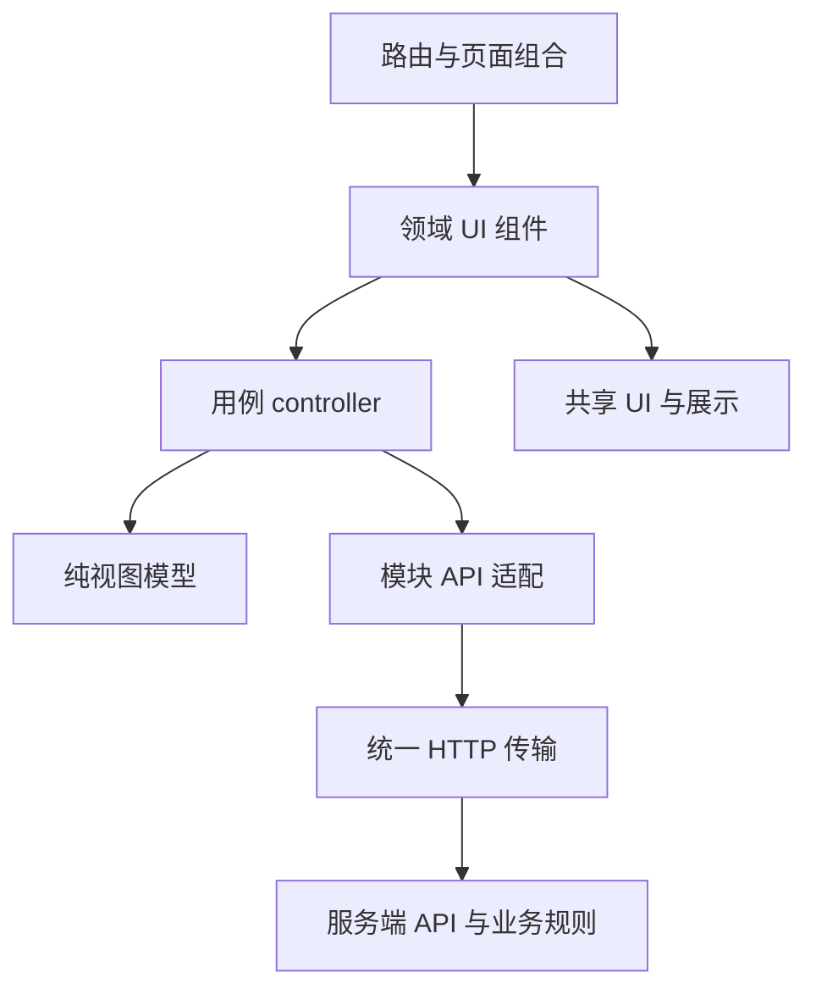

# Cardfolio 前端架构：模块、组件与分层

版本：v0.3（补充平台活动目录及管理边界）<br>
设计日期：2026-10-09<br>
状态：目标架构与渐进迁移设计；第 21、22 节前端骨架正在实施，第 23 节共享合同已提供，真实新增业务接口待实施。<br>
范围：现有年费功能及 [PRD 第 21—23 节](./PRD-WORKBENCH.md)。<br>
业务契约：[活动、周期奖励与待办架构](./ARCHITECTURE-ACTIVITIES-TODOS.md)、[银行活动目录与发布架构](./ARCHITECTURE-ACTIVITY-CATALOG.md)。

## 1. 三个概念如何同时使用

| 概念 | 要解决的问题 | 本项目的例子 |
| --- | --- | --- |
| 模块化 | 谁拥有哪段业务及其状态、接口和用例 | 卡片、年费、活动、刷卡任务、奖励、待办、通知、设置 |
| 组件化 | 哪些界面和交互可以独立维护或复用 | TodoRow、RewardClaimPanel、PeriodProgress、Dialog、DateField |
| 分层 | 请求、状态编排、展示和规则分别放哪里 | 页面组装 → 用例 controller → 查询/视图模型 → API 适配；基础组件只接收 props |

三个概念是不同维度。业务模块内部也分层、拥有多个组件；拆出几个组件但仍由一个根组件管理全部请求和全部业务状态，不能算完成业务模块化。

本次采用“按业务模块组织，模块内按职责分层”。继续使用现有 React、TypeScript 与原生 CSS；本次设计不要求引入新的状态库、UI 库或微前端。应用规模适合统一部署的模块化前端。

## 2. 年费基线与迁移现状

原年费基线入口是 `app/page.tsx → components/mvp-app.tsx`。首版检查时 `mvp-app.tsx` 为 2,027 行，集中包含 DTO、日期/金额展示、六类首屏请求、页面切换、卡片/进度/提醒命令、各页面、表单和详情弹窗。本轮已开始向 `src/frontend` 与 `src/contracts` 迁移；以下基线问题用于说明拆分动机，具体实现状态以代码与验证记录为准。

`components/api.ts` 已封装 HTTP 请求，但同时在 401 时操作 `window.location`；应拆开传输错误与应用导航职责。`components/dashboard-shell.tsx` 有另一套 Card/CardDraft 和界面，当前入口没有引用它，不应直接把它当成生产壳层继续扩展。

当前日历按浏览器 `Date` 生成月份和分组，提醒完成仅更新 Reminder。新增待办不能继续通过给旧提醒换一个标题来实现。

## 3. 目标目录与依赖规则

以下是目标目录；第 21、22 节已有部分目录与代码，第 23 节路由和 feature 尚待接入。

```text
app/                              # 路由入口、服务端会话与初始读数据
  (workspace)/                    # 共用持久布局，路由分组不改变 URL
    layout.tsx
    page.tsx
    cards/page.tsx
    activities/page.tsx
    activities/[participationId]/page.tsx
    bank-activities/page.tsx
    bank-activities/[catalogActivityId]/page.tsx
    admin/bank-activities/page.tsx
    admin/bank-activities/new/page.tsx
    admin/bank-activities/[catalogActivityId]/page.tsx
    todos/page.tsx
    settings/page.tsx
src/
  contracts/                      # 可序列化 DTO、命令 schema、稳定错误码
  frontend/
    app/                          # AppShell、Providers、导航、ActionDispatcher
    pages/                        # 跨领域页面组合，不拥有业务事实
      overview/
      card-detail/
      activity-detail/
      bank-activities/
      catalog-admin/
      todos/
    features/
      cards/
      annual-fees/
      activities/
      activity-catalog/
      catalog-admin/
      activity-rules/              # 纯规则模板组件/模型，无个人事实或请求
      spend-tasks/
      rewards/
      todos/
      notifications/
      settings/
    shared/
      ui/                         # Button、Field、Dialog、Toast、EmptyState
      display/                    # MoneyText、BusinessDateText、CardIdentity
      http/                       # apiJson、ApiError、request cancellation
      query/                      # 请求状态、取消、查询键与失效通知的轻量机制
      styles/                     # tokens、基础布局与可访问性基础样式
  modules/                        # 既有/新增服务端领域模块
  workers/                        # 后台任务
```

每个 feature 内采用相同结构：

```text
features/todos/
  index.ts                        # 唯一公开出口
  ui/                             # TodoList、TodoRow、TodoCalendar、SnoozeDialog
  application/                    # 查询/命令 controller、用例 hooks
  model/                          # 筛选、DTO → ViewModel、展示 selector
  api/                            # 该模块的 query / command adapter
  styles/                         # 模块范围样式
```

依赖规则：

- 页面可组合多个 feature 的公开出口；feature 不引用 pages/app。
- feature 内部 UI 只依赖本模块 application/model 和 shared UI；UI 不直接调用 fetch。
- application 依赖本模块 API 端口及 model；model 是纯函数，不依赖 DOM、HTTP 或 React 状态。
- API 适配依赖 shared/http 和 contracts，不引用 UI。
- shared 不引用任何 feature；contracts 不引用 React、服务器 repository 或数据库 schema。
- feature 不导入另一个 feature 的内部文件。跨领域编排放 pages/app，避免“待办 import 奖励、奖励又 import 待办”。
- 浏览器代码不能导入 `src/modules` 的仓储、队列、数据库或鉴权实现。允许共用经过明确审查的纯 DTO/验证/格式化代码，不用 type-only import 暗中耦合 ORM 实体。

## 4. 五层职责

| 层 | 负责 | 具体例子 |
| --- | --- | --- |
| 路由/页面组合 | 会话边界、URL、页面布局、跨模块组件组装 | TodosPage、CardDetailPage |
| application/controller | 加载、提交、冲突处理、按影响范围重查、批量任务状态 | useTodoWorkspace、useRewardClaim |
| model/ViewModel | 表单模型、查询参数、DTO 展示映射、纯 selector | TodoFilter、TodoRowModel |
| API/query adapter | 路径、序列化、请求取消、错误解析、数据生命周期 | TodoApi、RewardApi |
| shared UI/display | 独立界面控件及不作业务判定的格式化 | Dialog、ProgressBar、MoneyText |



层是职责边界，不要求每个小组件都新建五个文件。只有真实的加载、命令、模型或复用职责才拆层，避免把业务函数随意堆进通用 `utils`。

## 5. 模块与组件责任

| 模块 | 主要组件/用例 | 边界 |
| --- | --- | --- |
| cards | CardList、CardForm、CardIdentity、卡片命令 | 卡片身份与生命周期；卡详情跨域标签由 page 组合 |
| annual-fees | FeeEventPanel、FeeProgressForm、FeeTimeline | 保留原年费规则及处理路径 |
| activities | CardActivityList、ActivityEditor、EnrollmentPanel、PeriodPlanEditor | 来源、资格、报名、活动周期计划；不确认奖励到账 |
| activity-catalog | CatalogList、CatalogDetail、JoinActivityDialog、JoinPreview | 已发布目录及加入意图；不读取管理草稿、不确认个人资格 |
| catalog-admin | AdminCatalogList、DraftEditor、MemberPreview、PublishDialog、WithdrawDialog | 管理员内容维护；不读取成员私人进度/奖励 |
| activity-rules | PeriodTemplateFields、RewardTemplateFields、SourceFields | 私人/平台编辑共享的纯字段与展示，不拥有业务事实或请求 |
| spend-tasks | PeriodProgress、ProgressInput、SpendEvidenceList、QualificationForm | 预计/确定值、快照/逐条输入、官方核对 |
| rewards | RewardSummary、RewardConditionPanel、ClaimWindow、ClaimForm、ReceiptForm | 领取与到账分别显示和提交 |
| todos | TodoFilters、TodoGroups、TodoRow、TodoCalendar、TodoDetail、SnoozeDialog、CustomTodoForm | 行动处理、视图和筛选；不改报名/领奖事实 |
| notifications | NotificationHistory、NotificationPreferences | 通知记录与节点偏好；不形成第二份行动列表 |
| settings | ProfileForm、ExportPanel、DeletionPanel | 账户、时区、导出和删除 |

基础组件共享样式及交互，不承载活动枚举和业务 API。`StatusBadge` 接收已映射文字和 tone，不把所有领域状态硬编码进去；金额格式化只展示，不计算奖励资格。

第 21 节卡片活动摘要直接消费服务端组合 DTO：当前期目标/剩余、奖励、下一行动及日期。不要由卡片页逐活动逐周期请求后自行猜出摘要。

规则模板复用经 `activity-rules` 的公开出口，依赖方向为 activities/catalog-admin → activity-rules；纯模板模块不依赖这些 feature 的 controller。个人规则编辑与管理发布保存通过各自模块 adapter；页面负责组合卡片选择、加入与个人详情跳转。

## 6. 状态归属、查询与失效

### 6.1 四类状态

| 状态 | 所属位置 | 例子 |
| --- | --- | --- |
| 远端事实/读投影 | feature query/controller；以服务端为准 | 周期、奖励结果、TodoAction |
| URL 状态 | 页面路由 + 类型化筛选模型 | list/calendar、卡片、类型、搜索、状态、日期、月份 |
| 临时交互状态 | 最近的组件或局部 controller | 弹窗、选中行、表单草稿、提交中 |
| 会话级状态 | 应用 provider | 用户时区、session scope、当前 capabilities、主题、通知入口 |

不把全部卡片/活动/待办放进根组件，也不为每个列表复制一份可独立修改的业务真相。远端数据不持久化到 localStorage 充当银行事实。

### 6.2 查询机制

首版每个 feature controller 管理自己的请求结果、loading/error 和重查；shared/query 只提供取消、请求序列、查询键及失效通知等轻量机制，不自建全局规范化实体 Store 或完整缓存框架。UI 和纯 model 不绑定存储实现。

查询身份包含 session scope、资源、规范化筛选、日期范围及展示时区。退出或切换账户卸载旧 controller、取消未完成请求并清空旧结果，避免前一账户摘要闪现；会话切换后的旧响应不得写回新状态。首屏服务端 DTO 作为 controller 初值，避免客户端立刻重复拉取；敏感数据不能进入跨用户共享缓存。

每个 query 独立处理 loading/empty/error/refreshing；不使用全站六个请求的 `Promise.all` 让单个模块失败拖垮其他页面。列表可保留上次成功结果并标记更新中；筛选变化取消旧请求，或使用请求序列忽略晚到的旧响应。

| 命令 | 需要失效的查询 |
| --- | --- |
| TodoAction 完成/忽略/恢复/延期 | 行动详情、列表、日历、首页 attention、通知 |
| 周期/消费/核对更新 | 任务、活动详情与按卡摘要、奖励条件、待办/日历/首页 |
| 领取/到账结果 | 对应奖励、活动摘要、待办/日历/首页/通知 |
| 日期/规则未来修订 | 受影响周期、奖励、行动、日历范围和通知偏好 |
| 用户时区变化 | 分组、日历、首页日期展示；不改冻结业务周期 |
| 目录发布/下架 | 成员已发布目录、管理列表/详情；个人核对行动由系统消费者处理 |
| 明确加入目录活动 | 目录自己的已加入状态、私人活动、任务/奖励、待办/日历/首页 |
| 采用目录版本/跟踪决定 | 自己参与、周期/奖励条件、待办/日历/首页、目录自己的加入摘要 |

待办页使用一个 `TodoWorkspaceController` 持有共享筛选与本工作区的 action ID/version。列表和日历可有不同的查询范围及 marker，但当前行动版本由该工作区统一管理；成功命令应用服务端返回的行动版本，再重查受影响范围。跨页面通过类型化的资源失效通知重查各自数据，不把所有 feature 的实体集合搬到根 provider。

浏览器重新聚焦、用户操作和服务端给出的 `nextBoundaryAt` 触发重查；首版不承诺多浏览器实时同步。分页保持服务端 as-of/时区和查询条件，开始新查询时重置旧游标。

### 6.3 写请求与同步

每次用户意图生成稳定的命令 ID；请求重试保持相同幂等键，编辑参数后是新命令。controller 保留 `expectedVersion`，重复点击禁用提交；冲突时保留草稿、拉取新版本并提示差异，不自动覆盖他人或另一标签页的新结果。

普通业务命令在后端 workflow 中一起提交必要的业务结果、关联待办和调度，返回实际 action ID/version 及失效范围。controller 按该结果更新并重查，不轮询 operation 回执。通知投递和非关键统计仍可后台更新，区块单独显示其更新时间/刷新状态。

批量计划生成/改期的 `202` 只代表任务已排队，展示“计划生成中”及 job 进度；旧生效结果继续可读。Job 成功后再刷新生效周期、奖励和行动，失败保留草稿及重试入口。API adapter 使用明确的命令结果类型区分 committed 与 queued，不能沿用 `apiJson<T>` 的强制实体断言把 job 当业务实体。

事实写入采用服务端确认结果；领取、到账、达标等不作乐观成功。简单行动完成也以服务端版本响应更新，失败保留原状态和可重试错误。

## 7. 待办页与跨领域动作

### 7.1 一页两种视图

推荐导航为概览、我的卡片、待办、设置；活动通过卡片详情进入，也可从活动总览查看。`/todos?view=list` 为默认，`view=calendar` 为月视图。历史“年费日历”导航进入后者并预填年费类型。

筛选只在 `TodoWorkspaceController` 管理，URL 保存可分享/刷新/回退的条件；切换 list/calendar 保留卡片、类型、搜索、状态和日期。日历月份是展示窗口，不在切换时擅自清除已有日期筛选。

TodoGroups 与 TodoCalendar 共享过滤器、行动详情和命令 controller。日历无日期计数直接使用同筛选返回值；marker 不显示完成按钮。首页 AttentionList 复用行动展示组件和查询契约，只取少量近期行动。

### 7.2 动作分发

应用层拥有固定 `ActionDispatcher`，按服务端 `primaryAction.kind` 打开对应模块公开表单或详情：

| 动作 | 处理模块 |
| --- | --- |
| 处理年费 | annual-fees |
| 更新进度 / 核对达标 | spend-tasks |
| 记录报名结果 | activities |
| 核对领取条件 / 记录领取 / 核对到账 | rewards |
| 完成 / 忽略 / 恢复 / 稍后 / 自定义编辑 | todos |

todo 组件只发出类型化动作，不自己导入奖励 API；业务表单提交也不自己修改 todo 状态。AppDispatcher 在页面组合层连接模块的公开出口与查询失效。未知动作退到详情，不推断新命令。

官方入口由受控链接打开；打开网页不记录提交/领取/到账，不自动完成行动。按钮可操作性、禁用原因由服务端 DTO 提供，服务端在提交时仍重新校验。

## 8. 渲染、样式与可访问性

路由入口保持轻量，可在服务端完成会话与初始读数据；表单、筛选、月份选择和弹窗放到最小交互边界。服务端数据加载端口与浏览器 API 适配分开，复用 DTO；不把数据库查询导入客户端组件。

首版保持现有原生 CSS。逐步把 globals.css 拆为 tokens、基础布局、shared UI 和 feature 范围样式；组件只使用明确语义 token，不依赖另一个模块的 CSS 内部类。无需同时更换设计语言或 UI 框架。

桌面紧凑行和移动卡片使用同一 TodoRowModel、动作与语义 DOM，优先用响应式样式改变布局；不要维护两套请求、计算和业务 controller。只抽取有复用价值的组件，不因文件行数拆出大量无职责包装。

必须支持 360px、键盘、屏幕阅读器、焦点返回、表单错误关联、提交状态与日期/状态文字。逾期和临期不只用颜色。月格可用键盘打开当天行动；无日期、空状态、错误、无权限和同步中均有明确路径。

任务/领取的可操作性、日期分组与逾期基于服务端时区结果；前端格式化不改变日期语义。初始 DTO 的 `serverNow` 保持首屏一致，避免服务器与客户端跨日后出现不同标题/分组。

### 8.1 个人工具的交互层级（2026-10-16）

视觉使用黑白与暖灰：炭黑承担主按钮、链接、选中态和进度，暖白为画布，白色为内容表面，暖灰用于分隔、辅助信息和登录背景装饰。认证页、工作区、活动目录及管理页共用语义颜色变量；警示与错误仍用可辨认的状态颜色与文字。新增组件沿用这些变量，避免硬编码另一套品牌色。

登录是默认主入口：`/login` 只展示邮箱、密码和登录按钮，注册放在底部辅助链接，进入独立的 `/register` 页面。注册称呼为选填项；两页复用 `pages/auth/AuthPage`，继续使用原有认证接口与会话。

首页只保留“近期待办”和“我的卡片”两个区域。待办复用现有查询 controller，以 `TodoPreview` 展示标题、关联卡片、日期、紧迫程度和一个主动作；完整列表、延期、处理历史及业务核对仍在既有详情中操作。卡片最多预览三张并保留免年费进度，更多卡片进入管理页。未启用统一待办时，左侧回退为近期年费。

主导航固定围绕首页、卡片和待办组织；活动与目录放入“更多”，设置放在账户入口；没有次级功能时不显示“更多”。开发预览及验收场景不出现在用户导航中。增加业务模块时，先确定详情或次级入口，避免将领域状态、实现说明、重复统计和多组操作重新堆到首页。

“更多”的展开状态由持久的 `AppShell` 独立保存，切换首页、卡片和活动页面时保留用户手动展开或收起的选择，不随当前路由重设。首次直接打开活动页时默认展开。

工作区、银行活动与目录管理统一位于 `(workspace)` 路由分组，共用持久的 `WorkspaceFrame`。会话、权限、通知 controller 和 `AppShell` 由布局持有，页面只提供内容；独立开发验收入口可复用同一个 frame。菜单统一使用客户端路由，模块内筛选继续同步 URL 与浏览器历史。跨页面切换、当前菜单重复点击和浏览器前进后退均不重载文档、不卸载侧栏与顶栏，也不重新初始化账户和权限查询；内容请求失败或变慢只在内容区域显示状态。

middleware 为页面请求覆盖内部的 `x-cardcalendar-pathname` 请求头，工作区服务端布局据此在渲染会话层之前检查功能开关，未开放入口保持 HTTP 404。各路由与 API 继续执行自己的开关和权限检查。

新增卡片优先录入银行、卡名、尾号、年费金额、下次年费日期和免年费规则。新增默认使用中、人民币；币种、年费周期、进度周期和备注折叠到“更多设置”，状态只在编辑时提供。下拉框保留明确箭头与键盘操作，币种展示中文名称；折叠设置不清除已有值，校验失败时展开对应设置。

卡片管理默认展示搜索与列表，将状态、年费状态、达标情况、日期区间和排序收进“筛选与排序”。折叠后保留已选条件数量；搜索或筛选无结果时提供清除入口，不误报为账户尚无卡片。

新增活动先填写名称、所属卡片、日期、规则原文和奖励说明；仅有一张卡时自动选中。报名、渠道、周期目标、币种、计入口径和来源在“更多规则”中设置。修改名称时保留完整规则草稿；折叠区校验失败会展开并提示。银行规则更新、目录下架或银行取消消息自动展开来源区域，保留用户核对入口。

活动详情先展示当前周期的剩余目标、截止日期和奖励；其他周期按需展开。规则来源、周期配置、提醒偏好及处理历史放入次级入口。参与信息按规则中的报名要求、适用周期和名额要求生成，整个活动报名只记录一次，每期报名从对应周期进入；不展示全期与每期的三项核对矩阵。记录时固定适用范围，直接选择具体事项和银行结果，保留备注、权限、版本校验及失败草稿。参与信息、消费进度、官方达标、领取和到账仍各自独立，页面简化不自动确认任何银行事实。

## 9. 渐进迁移

| 步骤 | 工作 | 完成条件 |
| --- | --- | --- |
| 1 | 从 mvp-app 提取 DTO、HTTP、格式化、已有 Modal/Toast | 原年费行为与类型检查保持通过 |
| 2 | 提取卡片/年费/设置/通知 feature 及 controller，移除全局 refresh | 独立错误状态与按资源失效，现有 E2E 保持通过 |
| 3 | 提取 AppShell 和真实路由/URL 筛选，跨域详情放 pages | 刷新、回退、深链接及移动导航可用 |
| 4 | 新 todos 模块接年费、自定义待办和两视图 | 第 22 节年费范围、去重、时区、延期和恢复通过 |
| 5 | 增量加入 activities/spend-tasks/rewards | 第 21 节单周期至完整多周期闭环逐阶段验证 |
| 6 | 接入当前权限、activity-catalog/catalog-admin 与共享模板 | 第 23 节发布、草稿隔离及成员只读验收通过 |
| 7 | 加入私人卡片、差异确认采用及下架跟踪决定 | 第 23 节幂等/所有权/版本/历史与第 21、22 节联动通过 |

迁移期间每个资源只有一个写 adapter、一个查询状态归属和一套 DTO。旧入口暂时委托新模块，不长期开两套可编辑界面；`dashboard-shell.tsx` 若无用途，先验证无引用后单独移除。纯拆分与业务新增分开提交，便于判断回归来源。

## 10. 实施验收

本次仅交付设计，以下是后续代码验收要求：

1. 用静态 import 规则检查 shared/contracts 不引用 feature/server，feature 无跨内部导入，UI 无直接 fetch。
2. 活动、任务、奖励、待办分别拥有自己的类型、adapter 和 controller；根壳层没有全部领域实体数组和批量命令。
3. 切换列表/日历、刷新和浏览器回退保留筛选；同一 action ID/version 状态一致。
4. 卡详情、待办和首页打开同一奖励表单，命令语义和失效范围一致。
5. 无日期、不完整来源、未开放窗口、部分到账和取消/归档均显示正确动作与原因。
6. 一条查询失败只影响对应区块；旧请求晚到不能覆盖新筛选结果；退出后缓存不泄漏旧用户数据。
7. 同键重试、版本冲突、后台批量任务排队/失败有独立且可恢复的状态；普通保存成功后两视图读取同一已提交行动版本。
8. 时间边界按用户 IANA 时区更新；浏览器时区不同、跨午夜和夏令时不产生错误分组。
9. 核心流程覆盖 360px 与桌面、键盘和焦点恢复；原年费注册/建卡/进度/事件流程保持通过。
10. 查询加载、渲染和组合接口实测达到产品性能目标后再按对应范围开放入口。

组件测试应验证可见行为和重要交互；纯 model 测试验证筛选/DTO 映射及未知值；API/领域测试验证真正的业务规则。不能用前端按钮禁用测试替代服务端所有权、幂等和状态机测试。

## 11. v0.2 复核边界

本次明确首版的轻量查询控制：状态归 feature controller，列表/日历共享工作区，跨页面只传失效信号；全局 provider 保留会话与偏好。模块内的 ui/application/model/api 是职责划分，小型纯组件可以同文件组织，不为每个组件创建五层包装。

普通交互遵循已提交响应，批量任务遵循 queued/job 响应；前端不实现后端事务，也不把任务排队显示为业务生效。设计要先在原年费流程上验证拆分，再接入新的活动与待办。

## 12. 第 23 节框架与交接

平台目录 `/bank-activities` 和管理员 `/admin/bank-activities` 使用独立 adapter/query 身份；私人 `/activities` 继续表示本人的参与。模块目录、DTO 与权限合同见 [目录架构](./ARCHITECTURE-ACTIVITY-CATALOG.md)。共享 [catalog 合同](../src/contracts/activity-catalog.ts) 不依赖 React、鉴权或仓储，服务端端口保持在 modules/server 中，客户端不导入。

管理员草稿允许未知项；发布预览必须展示服务器校验、目录/草稿版本和内容 hash，用户明确确认后提交。成员只能读取已发布 DTO，管理草稿不能作为成员列表乐观数据。`CatalogResource` 补充目录、管理和会话能力的失效类型，接入时在既有失效机制中扩充，不另建全局缓存框架。

加入流程按当前用户卡片选择 → 服务端只读预览 → 确认未知项/私人边界 → join 命令 → 已提交参与或 job 状态组织。重复加入保持既有参与版本；规则更新显示 diff 并走 adopt，列表/日历中的核对 action 复用既有待办 controller。下架详情展示原因、原绑定 release 及继续/停止未来跟踪选项；银行确认取消使用独立来源证据，不能用下架推断银行结果。

Capabilities 属于当前会话状态：不在 localStorage 固化 admin。退出/撤权卸载管理 controller、清空草稿查询；403 显示失权及刷新入口。真实接口校验每次请求，隐藏导航和禁用按钮不构成授权。

架构师交付合同与公共端口；切图仔1负责第 21、22 节，切图仔2负责第 23 节的路由、组件、controller、adapter 与该功能配套后端和验证。正式管理/加入入口需要真实鉴权、目录持久化及加入事务；工作区边界与任务顺序见目录架构第 11 节。第 23 节的 9 项验收对应目录架构第 10 节，现有年费回归继续作为迁移基线。
